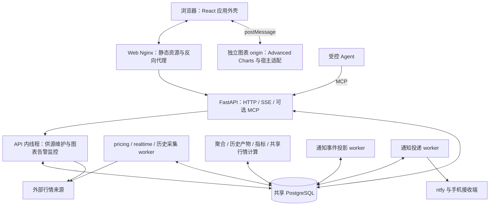

# Market Watch 架构分析

基线：`market-watch-integration-20261024`，`1293f8a4380e544f67448b88691c4296f6ec2e45`。
分析日期：2026-10-25—26 UTC。独立工作树：`market-watch-architecture-analysis-20261025`。

归档说明：准备合入时，集成分支已前进到 `b290c5a9`，其中 `2f26a71e` 移除了弃用的移动工作区。本报告和静态统计保留 `1293f8a4` 的分析快照，移动界面相关描述不代表后续集成版本；本次归档没有重新分析新增提交。

**结论：项目适合继续采用“单仓库、共享 PostgreSQL、按工作类型分进程”的路线。领域身份、历史版本、行情确认和事务投递的边界较明确；主要维护压力集中在图表消息桥接、API 内后台任务和跨模块数据库访问。优先收拢这些边界，比引入微服务或消息中间件更符合个人维护目标。**

## 1. 基线与分析范围

- 已执行 `git fetch origin`。远端没有同名集成分支，本次采用用户指定的本地集成分支 HEAD；该分支相对本地 `main` 为 0 落后、61 个提交领先。
- 集成提交 `1c8a8ac8` 已包含 FXCM 历史、历史维护模式和移动图表；基线后两次提交为资料整理。
- Python 和 Web 包版本均为 `1.27.0`。README 开头仍为 `1.26.0`，包含更早的生产状态叙述；不能据此判断当前架构或线上版本。
- 依据实际源码、Compose、迁移和 CI 定义分析。未读取生产凭据、连接生产服务、启动容器或修改业务代码。
- 本报告是当前源码的架构分析，不是性能压测、全量代码审查或生产运行状态认证。

## 2. 实际运行架构

这是一个**按业务模块组织、按工作类型拆分进程的单体应用**。各后台进程共享 Python 包、ORM 模型和数据库，没有独立服务数据库或服务间业务 RPC。

数据库同时承载价格、不可变版本、任务队列、任务租约、订阅结果、通知状态和审计记录。发布唤醒使用 PostgreSQL `LISTEN/NOTIFY`，但通知只是提示，持久任务状态才是事实来源；丢失唤醒时回到有界轮询。

证据：`compose.production.yaml:20`、`backend/alerts/storage.py:1080`、`backend/alerts/market_stream.py:1`、`backend/alerts/publication_wakeup.py:13`。

### 生产模板中的进程职责

| 进程 | 主要职责 | 运行边界 |
|---|---|---|
| `api` | HTTP、SSE、可选 MCP；启动供源维护与告警监控线程 | HTTP 与部分后台业务共享生命周期 |
| `pricing-worker` | OANDA 账户级价格采集、来源所有权与恢复 | stream / REST batch 由配置决定 |
| `realtime-worker` | 最新 M1 与近期恢复；REST batch 时排除 OANDA | 避免与账户采集者重复获取 OANDA |
| `chart-history-worker` | 旧绑定的历史补齐、导入任务、量补齐 | 历史网络工作单独执行 |
| `chart-aggregation-worker` | 自建图表发布和周期聚合 | 预算约束的计算与短事务 |
| `native-history-worker` | 平台原生历史分页加载 | 消费者句柄与共享数据集缓存分开 |
| `history-worker` | 历史维护、版本导入、产物、组合准备、固定及展示指标 | 一个进程仍承担多个阶段 |
| `composite-aggregate-worker` | 组合行情周期聚合 | 独立于供源网络维护 |
| `market-stream-worker` | 共享行情任务计算和结果提交 | 固定 4 个并发工作槽 |
| `notification-projector` | 把保留的业务事实投影为消息中心事件 | 可重放，不重新判定或投递 |
| `notify-worker` | 领取 Outbox、发送通知、记录投递结果 | 发送与业务判定分离 |
| `web` / `chart-origin` | 应用静态资源与 API 代理 / 隔离的图表运行时 | 两套静态镜像 |

模板共 15 个服务定义：13 个常驻服务，另有迁移和按维护 profile 启动的备份；外部 PostgreSQL 不计入。它描述仓库的部署意图，不代表本次核实了生产容器数量。

根 `compose.yaml` 仍是较早的 worker 组合，不能把它当作当前生产模板的完整替代。生产模板中 API 和 10 个 worker 的连接池通常各配置为 2、overflow 为 0：名义池容量合计约 22，另有 LISTEN 等专用连接；这不是实际连接数测量。

## 3. 领域模型：架构中最值得保留的部分

### 三类业务价格系列，四种查询类型

| 概念 | 身份与含义 | 典型实现 |
|---|---|---|
| 平台行情 `provider` | 供应商、账户、原生参数和周期明确的价格系列 | `provider_chart.py`、`provider_cache.py`、`native_series.py` |
| 固定历史 `history` | 已发布历史版本及其固定周期产物 | `history_versions.py`、`history_artifacts.py` |
| 组合行情 `composite` | 固定历史基线、明确拼接点、映射和后续实时尾部 | `composite_definitions.py`、`composite_revisions.py`、`composite_series.py` |
| 自建查询 `managed` | 既有自建数据与图表发布视图的读取路径 | `managed_dataset.py`、`chart_api.py` |

这里不能仅用 `EURUSD` 这样的显示代码作为缓存键或系列身份。`DatasetIdentity` 包含来源、通道、环境、账户指纹、供应商代码、价格口径和日历版本；`SourceIdentity` 进一步固定影响供应商返回值的请求参数。

历史维护已支持三种模式，不能再把所有来源都理解为 M1 聚合：

| 模式 | 基础数据 | 高周期处理 |
|---|---|---|
| `base_m1` | 来源 M1 | 按本地聚合规则生成周期 |
| `base_d1` | 来源 D1 | 依据来源交易日期生成周、月产物 |
| `native_periods` | 各来源原生周期 | 各周期独立归档、独立游标与证据 |

新模式使用 v2 身份；v1 身份保持原序列化字节，避免改变既有持久身份。最新迁移 `ay52_history_modes` 引入独立周期来源和检查点，迁移图只有一个 head。该迁移不提供向下删除数据的 downgrade；应用回退保留新 schema，schema 回退依赖经过验证的备份。

证据：`market_contracts.py:21`、`market_contracts.py:29`、`market_contracts.py:78`、`history_mode_sources.py:11`、`migrations/versions/ay52_history_modes.py:1`。

### 数据质量事实保持分离

项目区分时间已经结束、供应商确认、观察到的覆盖、确定闭市、临时价格和已确认价格。FXCM 平台快照明确返回“按时间判断结束、供应商确认未提供”，不会把它直接宣称为来源确认柱。空成功响应也不自动等于休市或历史到头。

这是行情工具的重要边界：保持价格和证据真实性，比统一成一个 `complete` 布尔值更有价值。扩展来源时应复用这套语义。

证据：`CONTEXT.md`、`provider_fxcm.py:10`、`provider_fxcm.py:59`、`market_contracts.py:99`、`coverage.py`。

## 4. 四条关键数据流

### 4.1 图表初始历史与指标

`Advanced Charts datafeed → bridge.js → postMessage → React 外壳 → /api/charts/data → query_chart → data_sync → 对应系列读取 → 返回图表`

`data_sync` 按系列类型分发：平台读取进入供应商缓存路径；固定历史和组合读取进入 `series_access` 及固定指标展示路径；既有自建数据进入普通或已发布行情读取。

`query_chart` 统一浏览器和 MCP 的超时、取消入口，并把同步工作放入线程。平台历史读取可能触发必要的上游获取，所以“API 只读数据库”只适用于共享行情 SSE 等特定链路，不适用于所有接口。

证据：`web/src/advanced/AdvancedWorkspace.tsx:473`、`backend/alerts/chart_api.py:856`、`:865`、`:1074`。

### 4.2 持续行情：按计算身份共享结果

`订阅注册 → MarketStreamTask / Subscription → market-stream-worker → 持久结果 → SSE → React → iframe`

任务按完整系列和计算参数共享；消费者状态另行保存。generation、result epoch、sequence、租约和接受凭据处理替换、重连、过期及旧结果。市场 SSE 每 0.5 秒检查已提交结果，不在每个连接内重新向供应商拉取或计算整段指标。

这一设计控制了多图、多页面重复计算。但消费者连接仍各自续租和查询，所以 API/数据库投递成本仍随连接数增长，不能据此推断无限扩展或零额外成本。

证据：`market_stream.py:86`、`:297`、`:394`、`market_stream_api.py:157`、`market_stream_worker.py:282`。

### 4.3 自建历史、实时尾部和指标

来源观测先形成可追溯历史证据，再生成历史版本和周期产物。组合使用明确的历史基线、拼接点和组合修订；实时来源的恢复或切换不应改写固定历史。

固定指标运行、输入策略、计算起点、需求租约和展示快照是独立概念。展示指标可绑定观察快照，后台判定读取已固定的身份与规则。这里的多个 revision / snapshot / epoch 有实际领域含义，不能为简化参数而合成一个全局版本号。

`history-worker` 的多阶段循环把每个阶段的异常分别记录，并继续其他阶段；但这些阶段仍共享单个进程和顺序循环，阶段耗时仍可能影响后续调度。

证据：`history_versions.py:121`、`:405`、`composite_revisions.py`、`fixed_indicators.py:118`、`indicator_demands.py:42`、`display_indicator_jobs.py:58`。

### 4.4 告警、手机通知和网页消息

`已绑定行情输入 → 告警判定 → 同事务写检查点 / 次数 / Signal / Notification / Outbox → notify-worker → ntfy`

告警逐条使用数据库事务，历史基线与已处理观察不会直接当作新信号重复发送。投递 worker 在短事务中领取任务，再在事务外执行网络投递，并记录后续结果。网站消息中心由独立 projector 重放业务事实生成，不负责重新触发告警。

“关闭网页仍监控”成立于服务端继续运行的前提；当前图表告警循环由 `provider_service.start()` 在 API 进程内启动。API 退出或重启时，该循环也会暂停。旧版监控还有 `market.py` / `live_pricing.py` 内的判定入口，不能笼统地说所有预警都在一个 worker。

证据：`chart_alert_service.py:302`、`:374`、`notify.py:59`、`provider_service.py:649`、`:689`、`alert_monitor.py:13`、`notification_center_worker.py:13`。

## 5. 前端实际上有三个运行面

1. **React 应用外壳**：登录、路由、工作区生命周期、HTTP / SSE、草稿恢复、通知运行时和移动导航。
2. **Advanced Charts 宿主**：独立 origin 的 iframe，提供 datafeed、原生图表交互、画线、指标及菜单适配。通过 `mw-chart-v1` 消息通道与外壳协作；父子双方都检查窗口来源、origin 和 channel。
3. **兼容图表与监控**：`web/src/charts/` 使用 Lightweight Charts，旧监控和历史演练仍可达。这不是已清理掉的死代码。

图表 origin 的 `connect-src 'none'` 和应用转发结构使业务 API 访问集中在外壳。图表内部分业务 UI 则由 React 构建产物注入，因此两套静态产物存在契约和发布配套关系，不能只把 iframe 当作一块完全独立的图片。

移动图表已经纳入当前工作区，但仓库 `mobile/` 的 Java 提醒应用是另一种接收端，不是 React Web 的 Android 原生实现；其 README 保留真机后台验收未完成的边界。

证据：`web/src/main.tsx:154`、`web/src/advanced/AdvancedWorkspace.tsx:210`、`:473`、`:2127`、`advanced-host/bridge.js:3128`、`advanced-host/nginx.conf:25`、`advanced-host/Dockerfile:1`、`mobile/README.md`。

## 6. 主要架构压力与优先级

下表是维护与运行边界的判断，不代表已复现故障。

| 优先级 | 事实与影响 | 建议 |
|---|---|---|
| 高 | 外壳 `AdvancedWorkspace.tsx` 2149 行、宿主 `bridge.js` 3482 行；消息分发同时覆盖行情、告警、工作区、偏好、通知和移动状态。修改一个行为需要跨运行面跟踪多个世代和取消状态。 | 先按消息域提取 handler；统一请求/响应类型及过期规则，保留现有 origin 检查和恢复语义。无需更换图表框架。 |
| 高 | API lifespan 启动每来源的预热/实时循环、清理和告警线程；API 重启同时影响后台图表判定。增加 API 副本也增加这些循环，即使数据库租约阻止冲突写入，扫描和生命周期仍耦合。 | 先显式列出后台角色与启动开关；若确需 HTTP 重启期间继续判定，再把现有循环作为独立角色部署。不要默认再增加一组服务。 |
| 高 | `market_stream_worker.py` 直接从 `chart_api.py` 导入 `DataQuery` 和 `data_sync`；MCP 的图表读取也复用带 HTTP 错误语义的路径。协议层兼任共享查询服务。 | 把查询模型和查询服务移入独立业务模块；HTTP / MCP / worker 保持薄适配。复用同一计算实现，避免新建第二套行情逻辑。 |
| 中 | 102 张 ORM 表集中于 `storage.py`；127 个模块在模块或函数内直接引用它。末尾导入通知事件钩子，模型定义和注册副作用相连。 | 随相关功能修改逐步按来源、历史、组合、告警、通知分组模型；保留兼容导出和一个事务入口。不要为拆目录同时改数据库。 |
| 中 | 共享数据库承担历史写入、查询、队列和事件；小连接池下存在资源竞争可能。SSE 仍每连接轮询；历史 worker 内还有顺序阶段。 | 先观测连接等待、任务最老等待时间、阶段耗时、SSE 投递滞后。只有实测瓶颈出现后再改并发或执行器。 |
| 中 | `/readyz` 主要验证数据库可用；`/api/health` 另有 worker、队列和业务状态。容器 ready 不等于价格新鲜或告警健康。 | 区分进程存活、基础依赖可用和业务新鲜度；在同一状态摘要展示来源心跳、最新确认柱、告警循环和队列进度。 |
| 中 | 图表构建期补丁绑定固定第三方 bundle，宿主还访问部分内部图表对象；构建已做指纹和内容校验。 | 保留固定版本与失败即停止的校验，集中补丁清单和升级契约测试。版本升级应独立验证历史导航、保存、告警和指标适配。 |
| 低、低成本 | README、根 Compose、生产模板及历史交付资料并存，版本与进程拓扑有漂移。 | 增加当前架构入口与进程职责表；把历史交付资料标为历史证据，避免用旧说明替代当前源码事实。 |

对应证据：`provider_service.py:649`、`api.py:52`、`chart_api.py:124`、`market_stream_worker.py:13`、`storage.py:1718`、`api.py:385`、`worker_health.py:10`、`advanced-host/build-assets.mjs:1`、`advanced-host/patch-native-reserve.mjs`。

## 7. 建议的演进方向

建议把现有实现逐步收拢成六个清楚的模块面：**供源与身份、历史与发布、实时与组合、指标计算、告警判定、通知投递与投影**。HTTP、MCP 和后台 worker 只是这些模块的调用入口。UI 的 iframe 协议单独作为跨运行面的契约。

推荐先做三件具体且收益明确的事：

1. 建立当前进程和数据流索引，明确谁获取价格、谁发布结果、谁判定告警，消除 README 与部署定义的混用。
2. 从 `chart_api.py` 提取共享查询入口，同时从大消息监听器提取行情和告警两个 handler；保持数据库、请求参数和用户行为不变。
3. 显式化 API 后台角色与业务健康摘要，再根据实际重启和排队证据决定是否迁出独立进程。

随后再按功能演进拆分 ORM 模型及剩余宿主消息域。每次验证一条真实跨界行为：切换系列时旧请求作废、断线重连恢复、固定历史不被改写、告警判定与投递不重复。避免只做文件拆分而没有减少调用方需要知道的细节。

当前没有证据支持引入 Kubernetes、Kafka、独立数据库或全面改为事件溯源。数据库任务、租约、不可变历史与 Outbox 已解决许多实际问题；新增基础设施会直接增加个人运维成本。

## 8. 静态证据与验证边界

统计只针对该提交 Git 跟踪的文件。行数包含注释和空行，不作为质量或性能评分。Web 与图表宿主排除各自 vendor / charting_library，未把第三方压缩包计入自研规模。

| 范围 | 文件 | 行数 |
|---|---:|---:|
| `backend/alerts/**/*.py` | 181 | 42354 |
| `web/src` 的自研 TS / TSX / JS | 99 | 24762 |
| `advanced-host` 的自研 JS | 45 | 15447 |
| `backend/tests/**/*.py` | 265 | 45965 |
| Alembic 迁移 | 57 | 2157 |

静态 import 图包括函数内部延迟导入时，有 87 个模块处于同一最大强连通分量；仅统计模块体直接导入时，最大分量为 2 个模块（`storage` 与通知钩子注册模块）。这说明存在较广的相互调用关系，**不能把 87 个模块解释为启动循环导入故障**。统计也不覆盖动态 import 或实际函数调用图。

已有 265 个后端测试文件、499 个 Web 测试脚本文件。CI 包含 PostgreSQL 14.24、Python 测试、Web 构建、宿主 VM/DOM 回归和 Compose 验证。文件数量和工作流配置只说明验证范围；不证明本次 HEAD 全部通过。

本次实际完成：

- 238 个后端/迁移 Python 文件 AST 解析。
- 45 个自研图表宿主 JS 文件 `node --check`。
- 57 个迁移的静态父节点检查：无缺失父节点，唯一 head 为 `ay52_history_modes`。
- 代码与部署职责交叉核对、Git HEAD 固定和资料一致性检查。

未运行全量测试、Web 构建、浏览器验收、供应商请求或压测；未测量生产吞吐、延迟、资源用量和手机投递。没有据此宣称运行稳定、性能达标或不存在其他缺陷。

原始证据：[静态统计](static-metrics.json)、[本次验证记录](verification.json)。本次归档仅包含分析资料，不修改业务实现。
