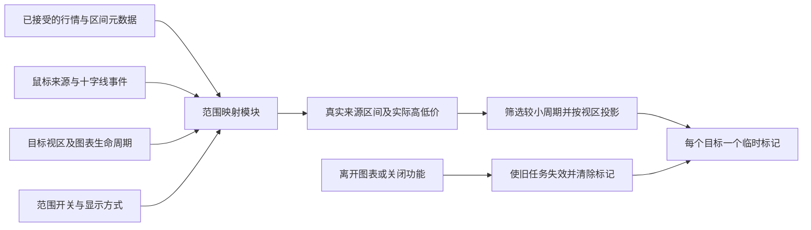

# K线范围映射：实施方案

2026-10-04。方案基线：`62488c6035dbea9533699d569a6605f82c684303`。
本文保留实施前方案。实际实现采用阶段 A 允许的 SHA 校验原生绘制层备选，原因、最终基线与隔离验收见[验收记录](chart-bar-range-mapping-acceptance.md)。

## 1. 推荐方案与范围

在现有原生专业图表中新增一个范围映射模块，复用已到前端的行情和公共临时绘图接口。来源 K 线的真实时间区间作为权威状态，目标图只显示该区间与当前视区的交集。

[需求文档](chart-bar-range-mapping-spec.md)为交互依据。实施时遵守以下规则：

- 原生同步菜单中，十字线同步下方增加 **K线范围映射**；同时提供 **淡色背景 / 高低价矩形** 选择。默认关闭功能，开启后的默认样式为淡色背景。
- 十字线同步与本功能都开启时，跟随鼠标实际所在图的有效 K 线，映射到同一行情身份的更小周期图。
- MN 只映射 D1 及以下，跳过 W1；其他周期严格按大小映射。
- 映射不改变视区；用户使用已有时间同步功能决定是否跳转。
- 鼠标离开行情图或进入菜单后立即清除。无有效来源、无符合条件的目标、关闭必要开关时同样清除。
- 未完成 K 线保留完整预计周期；高低价矩形使用已发生行情的实际高低价并随行情更新。

默认关闭、按工作区保存开关与样式、主图显示等采用需求文档中的建议默认值，作为本方案的实施选择；不是新增一轮用户确认要求。

首版面向当前时间周期 K 线主图。真实区间或行情身份无法可靠确定的图形不生成标记。用户画线、指标值、Renko/Range 等合成 bar 不直接当作原始行情 K 线；这些类型不作本方案已验证能力。没有真实鼠标悬停来源的触屏单图不新增选 bar 手势。

## 2. 数据流与模块接口



新增 `advanced-host/bar-range-mapping.js`，内部统一管理来源判定、元数据索引、周期规则、逐帧调度及临时绘图生命周期。桥接和菜单只使用小接口，避免将这些规则散落到多个事件回调。

建议外部接口如下；名称可以在实现中调整，但职责和不变量保持一致：

| 接口 | 调用方与合同 |
| --- | --- |
| `chartBarRangeMapping(options)` | 接收当前 widget、原生文档、初始配置、只读状态及配置变更通知；内部绑定鼠标、十字线和视区事件 |
| `observeBars(batch)` | 桥接仅发布已接受的原始行情批次及数据代次；无 RPC、副作用取数或指标行情输入 |
| `configure({enabled, style})` | 菜单修改配置；只有用户配置修改触发工作区脏状态 |
| `refreshCharts()` | 布局、商品或周期变化后重新核对当前图表实例，解绑退出的图表并绑定新图表 |
| `suspend()` | 加载/重建前使全部旧来源与异步任务失效并清除对象，直到当前图表重新绑定 |
| `snapshot()` | 只返回版本、开关、样式等可保存配置 |
| `dispose()` | 销毁订阅、观察器、调度和临时对象，保证重复调用安全 |

模块依赖原生 widget 与浏览器事件，通过注入依赖进行行为测试。内部可以分为计算和绘制函数，但不为单个实现另建通用插件框架或额外网络接口。

### 来源语义状态

每次有效选 bar 保存以下小对象：

```text
workspaceEpoch + sourceChartInstance + dataGeneration
seriesIdentity + resolution + chartTime
start + end + high + low + complete
sourceVersion
```

`start/end` 统一为真实 UTC 毫秒，绘图调用前在一个位置转成秒。`chartTime` 只用于在来源图上识别 bar。`sourceVersion` 用来拒绝已过期的绘图任务；它与历史请求/数据代次分开，鼠标移动不取消原有历史导航。

## 3. 已加载行情的最小区间索引

### 保存什么

`barsOf` 当前会丢弃真实起止时间。范围模块需要保留接受批次中原始行情的 `chart_time/start/end/high/low/complete`，以及系列身份、交易日历和有效数据代次。OHLC、volume 和指标序列不另做完整缓存。

十字线事件中的 `entityValues` 是格式化显示值，不用于解析实际高低价。读取数值行情和真实区间，避免语言、精度、千位分隔符及百分比显示影响结果。

### 接入位置

在 [bridge.js](../advanced-host/bridge.js) 中覆盖：

1. `getBars` 经筛选和有效代次检查后，实际交给原生图表的历史批次。
2. provider 推送的已接受 bars；`reset` 或历史重建首先失效旧代次。
3. managed 行情轮询的已接受更新及历史更正。
4. 布局载入、商品/周期切换和数据源重建的回收入口。

不直接让纯转换函数 `barsOf` 无条件写入索引：过期响应、未被接受的行或 Python 指标专用 ticker 不得覆盖当前来源。

### 控制内存与代次

- 索引使用真实系列身份和周期，记录来源窗口/数据代次。外显同名但 `provider/managed` 不同的序列按不同身份处理；可复用 [series.js](../advanced-host/series.js) 的身份规范。
- 相同序列、相同有效数据窗口允许共享；不相接的历史窗口不能被拼成一段连续缓存。
- 基础保留量跟随当前原生图表有效窗口；开启映射时保证已接受的可见来源 bar 有元数据，关闭后仍维持有限保留或停止新增。
- 来源失效、窗口退出、工作区加载时解除引用并回收。长期拖动不能使索引随累计响应无限增长。
- 具体有效窗口识别及回收方式在第一阶段验证。若公共能力不能可靠识别，接入已有数据窗口代次和经过版本校验的原生观察入口；不能用任意 LRU 淘汰当前可见 bar 后声称功能完整。
- 不依赖绘图对象的端点保存语义区间。矩形实时更新复用该索引中的最新合法行情。

后端已有 `start/end/chart_time`，本方案不新增鼠标移动取数接口。第一阶段若发现真实端点合同有误，应在对应行情序列统一修正并验证，范围模块不另写近似日历。

## 4. 鼠标来源与即时隐藏

当前一次来源 hover 会引起所有联动图表发出 `crossHairMoved`。不能简单把最后发事件的图设为来源。

- 使用真实指针进入/移动所在主图作为来源归属；原生 `isHovered` 可作辅助证据，不能只依赖“是否碰到 K 线实体”或 `activeChartIndex()`。
- 来源图本次十字线时间必须匹配已加载的有效行情 bar。未来空白、轴标签、菜单、无数据位置没有有效来源。
- 目标图的同步十字线事件不更新来源；目标视区变化只重新投影当前来源。
- 鼠标在同一 bar 内移动，区间与高低价不变时跳过绘图更新；新 bar、来源更换和实时 high/low 变化才更新语义状态。
- 关闭、离开、加载前先增加来源版本、取消待执行帧，再删除已有标记。隐藏路径不等待网络、历史就绪或导航完成。
- 创建绘图是异步操作：完成后检查当前工作区、图表实例、数据代次和来源版本；不匹配则立即删除该对象，禁止旧对象重新出现。
- 每个目标最多一个创建任务在途。新移动只覆盖待应用状态；旧任务结束后应用最新有效状态，避免鼠标移动生成无限 promise/对象。

验收要用真实 Playwright 鼠标覆盖图间切换、整屏拖动时保持按下、进入菜单和快速离开，不能只调用 `crossHairMoved` 回调模拟。

## 5. 原生临时绘图与时间投影

### 优先采用的绘图方式

| 显示方式 | 原生候选 | 表现 |
| --- | --- | --- |
| 淡色背景 | `date_range` | 上下延伸至主图可见高度；透明线条和统计文字；淡色填充 |
| 高低价矩形 | `date_and_price_range` | 以来源 `low/high` 为价格范围，屏内裁剪；淡色填充，不增加独立竖线 |

采用 `lock/disableSelection/disableSave/disableUndo`、隐藏对象树、下层绘制。更新复用 `setPoints/setProperties`；显示方式改变需要更换图形类型时，先使旧任务失效再替换。每个符合条件的目标最多一个标记。

已有[绘图证据](verification/chart-bar-range-mapping/evidence.json)及[开启原生画线同步后的兼容证据](verification/chart-bar-range-mapping/drawing-sync-compatibility.json)：D1 背景在 H4/M5 的创建、更新、删除没有传播到来源 D1 和 W1，时间/价格视区及撤销栈不变，观察期没有自动保存事件。这支持优先使用公共临时绘图；矩形和持续交互仍需按同样条件验证。

### 真实时间与目标坐标必须分开

1. 来源保留完整真实 `[start,end)`。
2. 以目标图的真实交易时间解释可见区域，求与来源区间的交集。
3. 将交集投影到目标原生图的时间坐标，再更新临时绘图。分钟图一般使用真实时间；D1 的日期标签应根据该目标交易日历及实际 bar 区间转换。
4. 不相交则移除该目标标记；未来相交部分也着色，遵守目标原本允许的视区。

**不能对所有周期直接用 `max(start, visible.from)`。** `getVisibleRange()` 的 D/W/M 值可能是日期标签，而来源 `start/end` 是真实会话时间。NY17 或 Yahoo 的日线目标需要根据区间/标签投影；未来没有 bar 时需使用同一交易日历的原生可见刻度或已验证投影入口。用户改变显示时区不得改变覆盖区间。

历史缺口、周末等没有实际 bar 的时段沿用原生时间轴表示，不生成虚假 K 线，也不为覆盖背景补历史。目标小周期 bar 位于来源边界时以真实时间交集判断；仅显示相交部分，不扩大到整个相邻周期。

### 月线未来端点限制

已实测原生 MN → M5 全时段图形会将远未来结束点吸附到当前 bar。采用“完整语义区间 + 当前视区投影/裁剪”防止把吸附后的图形当作真实范围。

合成 UTC 的可见未来裁剪已通过；所有真实交易日历的投影还未通过全量验证。第一阶段必须解决 NY17 的 MN → D1、MN → M5 和未来空白，包含图形端点半 bar 像素误差。若公共临时绘图无法满足正确性和无副作用条件，则在**同一范围模块内部**切换到独立绘制层，复用来源和投影逻辑。

独立绘制层只作为验证失败后的备选：覆盖主图、`pointer-events:none`，通过已有 SHA 校验适配入口获得可靠的时间与价格投影；它也必须满足主图边界、对数/倒置价格轴和主题要求。不能靠关闭用户画线同步或自动缩放规避失败。

## 6. 菜单、工作区保存和生命周期

- [chart-menu.js](../advanced-host/chart-menu.js) 扩展原生同步菜单，在十字线同步下一行增加范围开关；样式选择作为该功能的附属选择项。
- 关闭十字线同步时，范围开关不可用并显示简短说明“需开启十字线同步”；保留选择配置，重新开启同步后等待新的有效来源。
- 菜单按原生重建方式重新挂载，使用自身稳定 `data-name` 判断是否已经存在；验证键盘操作、主题和布局重建，不复制不稳定的用户事件处理器。
- 工作区新增配置字段 `_mwBarRangeMapping: {version:1, enabled:false, style:"background"}`；值严格校验，旧工作区缺省关闭，未知值回到安全默认。
- 覆盖启动解包、原生保存、另存、工作区加载及重建。加载前从传给许可库的状态中移除该自有字段；范围模块接收配置，首次恢复不画旧标记。
- 鼠标移动、更新标记和隐藏不触发工作区脏状态；只有用户改开关/样式才按已有保存规则标记更改。临时对象不进入样式模板或用户画线状态。
- `chart_load_requested` 立即暂停并清除；最终 `chart_loaded` 后绑定当前实例；`layout_changed` 对新增、退出图执行绑定/回收。商品、周期、历史 reset 以新的数据代次重新开始。
- `pagehide`、宿主重建和模块销毁时释放订阅、观察器与对象。只读工作区不保存配置，不恢复瞬时鼠标状态。

## 7. 代码改动清单

以下为计划改动，不表示已经编辑产品文件。

| 文件 | 计划职责 |
| --- | --- |
| `advanced-host/bar-range-mapping.js`（新增） | 集中实现映射状态、元数据、来源识别、投影、绘图及清理 |
| [bridge.js](../advanced-host/bridge.js) | 发布已接受行情、创建模块、接入保存/恢复及数据源生命周期 |
| [chart-menu.js](../advanced-host/chart-menu.js) / [chart-menu.css](../advanced-host/chart-menu.css) | 原生同步菜单功能行及样式选择 |
| [index.html](../advanced-host/index.html) / [build-assets.mjs](../advanced-host/build-assets.mjs) / [Dockerfile](../advanced-host/Dockerfile) | 新模块加载、打包与镜像文件清单，保持资源内容摘要更新 |
| `web/tests/advanced-bar-range-mapping.cjs`（新增） | 模块接口的行为测试，覆盖过滤、代次、失效与保存配置 |
| `web/tests/advanced-bar-range-mapping.browser.cjs`（新增） | 真实原生库与实际鼠标行为、像素、无副作用验收 |
| 版本校验的许可库适配脚本（条件项） | 仅当第一阶段证明公共投影或窗口观察不足时扩展最小入口 |

通常不需更改后端 API、数据库或预热机制。区间合同验证若发现后端既有问题，单独说明所需修正并增加真实日历验证。

## 8. 实施顺序与完成门槛

| 阶段 | 工作与产出 | 进入下一阶段的条件 |
| --- | --- | --- |
| A：验证技术入口 | 使用实际库验证真实鼠标归属、有效窗口回收、NY17/UTC/Yahoo 的真实区间到目标标签投影、两种样式及原生菜单位置 | 真实日历和可见未来范围正确；绘图方式不会传播、改轴、入撤销或触发自动保存；确定公共绘图或内部备选 |
| B：实现范围模块 | 接入已接受行情，完成周期过滤、按帧合并、复用绘图、立即隐藏、实时高低价、旧任务失效 | 核心行为测试通过，2/4 图实际鼠标跟随，无来源反馈和旧对象复活 |
| C：集成与持久化 | 原生菜单、工作区保存/另存/恢复、主题、布局/商品/周期切换、打包资源清单 | 配置可恢复、瞬时对象不恢复，已有画线和工作区行为不退化 |
| D：完整浏览器验收 | 9 周期规则、2/4/8 图、日历边界、远历史/未来、整屏拖动按住、保存并发和持续移动性能 | 需求验收矩阵通过，证据归档；真实范围错位、历史请求增长、视区改变或残留任一存在均不完成验收 |

阶段 A 的探针属于实现准备工作，不能把已完成的 UTC 静态绘图测试当成阶段 A 全部通过。

阶段 D 额外记录帧耗时与对象/内存情况：调度每目标每帧至多一次，8 图时至多 7 个标记；离开后对象为零，持续移动无对象或请求增长。可在固定验收环境采用来源改变到可见标记 P95 ≤ 50ms 的初始响应目标；这是拟定验收预算，当前未实测，不承诺所有设备均达到。

## 9. 与现有同步修复的关系

范围模块可以在时间同步关闭时独立验证；正常 hover 不等待后端。用户开启时间同步并点击远历史时，定位行为仍由[现有跨周期修复方案](chart-cross-period-sync-fix-plan.md)负责。

该修复合入后，在最终视区/数据就绪事件重投影当前有效来源，即使鼠标不动也应立即显示正确范围；离开后禁止导航完成事件恢复旧标记。修复当前仍未完成时，不能把“定位后无需晃动鼠标”的整条流程声明为已验收，也不将历史窗口修复混入此功能的范围模块。

开发从包含所需同步修复的清洁基线或独立功能分支开始，保留当前其他任务的改动。本方案完成后具备开发依据；进入代码实现与发布仍按用户后续安排执行。
