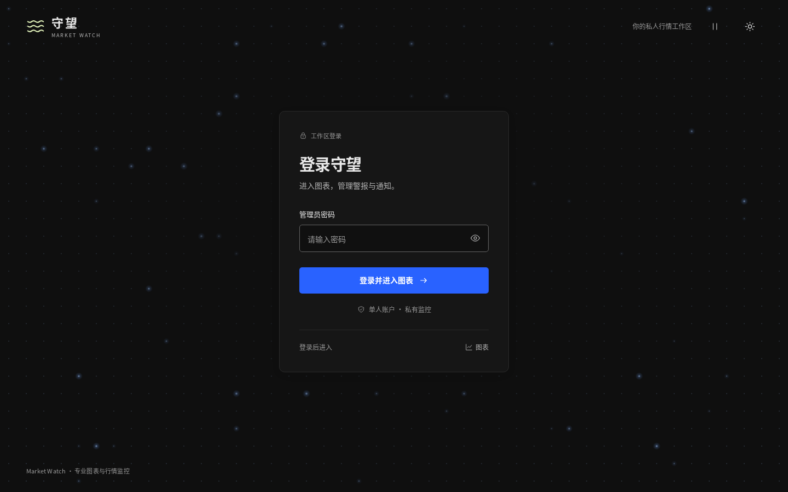

# 登录页定稿：A · 极简居中＋呼吸点阵

确认日期：2026-10-17。用户已明确认可并确定本方案。正式实施遵循[路由、导航与登录主方案](../../research/single-app-routing-navigation-proposal-20261017.md)中的登录、深链接恢复和会话规则；本目录固定视觉样例与动态行为，不代表正式应用已经改版。

## 已确认的设计

- 布局使用 A · 极简居中：品牌在左上，窄登录卡片居中，密码输入和一个主按钮；保留专业图表 / TradingView 风格的深灰底、细边框、蓝色操作色，同时支持浅色。
- 背景使用第二种 **Magic UI Dot Pattern / Glow**：固定的灰蓝点阵，少量点缓慢呼吸发光，不移动登录卡片；卡片保持不透明，周边减弱点阵。
- 桌面、手机使用同一登录流程。B · 图表分屏和 C · 工作台锁屏作为历史设计保留，不作为正式入口。
- 图表页继续使用现有左上汉堡菜单。本次登录设计不增加图表导航栏，也不改变图表布局或顶栏高度。



| 主题 | 桌面 1440×900 | 手机 390×844 |
| --- | --- | --- |
| 暗色 | [查看截图](glow-dark-desktop.png) | [查看截图](glow-dark-mobile.png) |
| 浅色 | [查看截图](glow-light-desktop.png) | [查看截图](glow-light-mobile.png) |

## 动态行为与实现约束

点位固定，选中的点以 7–12 秒周期改变亮度和少量尺寸；整体低对比，登录框周围更安静。静态底纹使用一个 SVG pattern，动画点上限 64 个；当前预览在 1440×900 下为 54 个，在 390×844 下为 14 个。实现使用原生 SVG/CSS，没有引入 Motion、WebGL、真实行情或图表实例。

右上角在主题开关旁提供动画开关。表单获得焦点、提交中及成功状态暂停背景；失去表单焦点后按用户选择恢复。页面隐藏时暂停，系统启用 `prefers-reduced-motion` 时显示静态点阵。暂停、恢复和切换主题不能重建密码输入框，须保留值、焦点和光标。

正式登录沿用现有账户与认证接口。普通进入按钮为“登录并进入图表”；从通知等深链接进入时为“登录并继续”，并显示对应目的地说明。错误、提交中、连接失败和已登录恢复仍按主方案处理；设计预览中的模拟提交不得作为真实登录实现。

## 引用示例

视觉与动效参照 [Magic UI 官方 With Glow Effect 演示](https://magicui.design/docs/components/dot-pattern#with-glow-effect)，源码固定于 `magicuidesign/magicui@85f97fd27b053339af74ba9dd4ca428ee25989fb`：

- [Dot Pattern 组件](https://github.com/magicuidesign/magicui/blob/85f97fd27b053339af74ba9dd4ca428ee25989fb/apps/www/registry/magicui/dot-pattern.tsx)
- [Glow 示例](https://github.com/magicuidesign/magicui/blob/85f97fd27b053339af74ba9dd4ca428ee25989fb/apps/www/registry/example/dot-pattern-with-glow-effect.tsx)
- [保留的 MIT 声明与适配说明](MAGIC_UI_LICENSE.md)

原例默认 `glow=false` 是静态点阵；动态示例需要 `glow=true`。本项目保留固定点阵与亮度呼吸的效果，降低频率、限制动画点数，并增加输入暂停、页面隐藏和减少动态处理。正式实现以这里已确认的预览为准，不直接套用原例的密集动画参数。

## 可访问预览与来源

- [暗色动态预览](http://192.168.7.232:18717/login?variant=A&background=glow)
- [浅色动态预览](http://192.168.7.232:18717/login?variant=A&background=glow&theme=light)
- [暂停动画对照](http://192.168.7.232:18717/login?variant=A&background=glow&motion=paused)

实际运行主机为 **quant-server / Ubuntu 22.04.5 LTS**，Docker project 为 `mw-login-prototype-20261017`；一个静态 Nginx 容器，内存上限 64 MiB、CPU 上限 0.25，无数据库和持久卷。回环地址为 `http://127.0.0.1:18717`。本次仅引用既有预览，没有新增服务。

原型 worktree 为 `/home/quant/repos/market-watch-login-prototype-20261017`，分支为 `prototype/login-options-20261017`，确认样例来源提交为 `52a2436`。本目录复制截图与验证记录，使主方案不依赖该 worktree 的文件链接；原型 HTML/CSS/JS 仍在原型分支。

```bash
docker compose -f /home/quant/repos/market-watch-login-prototype-20261017/web/login.prototype.compose.yaml up -d
docker compose -f /home/quant/repos/market-watch-login-prototype-20261017/web/login.prototype.compose.yaml down
```

## 已有验证

[原型浏览器记录](browser-review.json)覆盖深浅主题各 5 个宽度（320、390、768、1024、1440），并核对原 A 在 320、390、1440 下的卡片、输入与按钮位置和尺寸。已验证动画运行/暂停/恢复、输入值与光标保留、减少动态、主题切换和模拟表单状态；无脚本错误、HTTP 失败或外部/业务 API 请求。

页面隐藏暂停使用 headless 中模拟的可见性事件验证；没有据此声称完成真实设备的能耗或性能测量。登录、路由、浏览器动态标题和彩色收藏的正式接入尚未实现。
