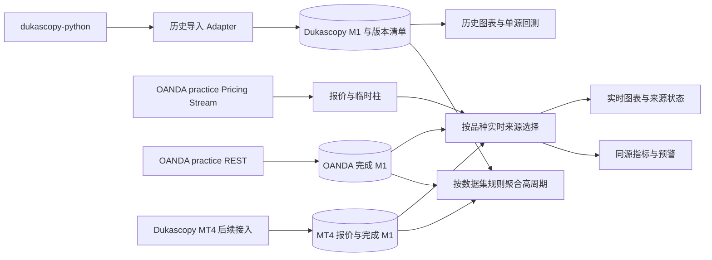

# Dukascopy 历史与 OANDA / MT4 实时行情接入方案

日期：2026-10-06。状态：方案定稿；P0–P2实现验收通过，质量验收未通过。
设计审计基线：v1.7.0，62488c6035dbea9533699d569a6605f82c684303。
接续实现基线：origin/main，3c18f60；包含 v1.8.0 生产记录及 v1.9.0 指标源码。
接续范围更新：用户于本会话明确将 MT4 实时行情接入留到后续；当前完整实现与验收范围为 P0–P2。
第8节和 P3 保留为后续设计，当前 OANDA 故障只降级，不切换尚未接入的备用。
原设计会话仅形成方案；本会话按用户接续开发指令推进 P0，进度见
[接续开发记录](market-data-integration-progress.md)。生产发布、交易和付费授权未包含在开发范围中。

## 1. 已确认决策

| 项目 | 用户确认 |
| --- | --- |
| 主历史 | dukascopy-python，约十年 M1，自己合成其他周期 |
| 首批品种 | EURUSD、XAUUSD；设计可扩至 3–10 个活跃品种 |
| 当前实时 | OANDA v20 practice，为主源 |
| 后续实时 | Dukascopy MT4，与 OANDA 互为备用，允许实时价格差异 |
| 回测 | 只使用单一 Dukascopy 历史数据集；实时切源不覆盖该历史 |
| 时效 | 主要关注 M1 收盘，可接受 15–30 秒；严格 1 秒尚未承诺 |
| 复用 | 扩展现有数据接入体系，复用现成 SDK、缓存、入库、聚合与预警 |
| 原设计范围 | 形成设计文档；2026-10-06 用户已指令接续开发，验收按阶段执行 |

首版不依赖 dukascopy-node 提供关键实时行情。已有 Node 适配器保留用于兼容与人工核对，不安排自动双 SDK 轮询或失败后跨 SDK 重试。主历史选型不等于已经验证十年完整覆盖或生产可靠性。

其他市场来源定位（交接前会话中的推荐，用户未提出修改，不视为新增功能承诺）：Binance 继续为 BTCUSDT 等加密货币提供同源历史与实时；BTCUSDT 现货与 Dukascopy BTCUSD CFD 不默认互备。yfinance 保留股票、ETF、指数的辅助查询、历史图表和较低频分析。单一 Dukascopy 回测决定适用于本次外汇/黄金，不能扩展为全部资产；不撤掉既有 Binance/yfinance 接入。

## 2. 现有能力与需要扩展的部分

| 文件 / 模块 | 已有能力 | 本方案改动方向 |
| --- | --- | --- |
| [market.py](../backend/alerts/market.py) | fetch_source 路由、M1 入库、收盘保护、预警调度 | 接入历史 Adapter；保留来源校验；拆开历史补数与实时事件语义 |
| [providers.py](../backend/alerts/providers.py) | OANDA practice REST 报价、complete M1、账户品种目录 | 复用完成柱读取，明确环境及结构化失败；核对账户范围 candles 兼容性 |
| [provider_service.py](../backend/alerts/provider_service.py) | 共享缓存、后台刷新、浏览器订阅和 SSE | 接受报价更新；SSE 消费采集结果，不建立每浏览器上游连接 |
| [provider_capabilities.py](../backend/alerts/provider_capabilities.py) | 原生图表 OANDA/Binance/Yahoo 能力 | 扩展能力描述，区分报价、临时柱、完成柱、历史覆盖 |
| [market_data.py](../backend/alerts/market_data.py) | 按需历史、品种目录、自建数据集入口 | 扩展 Dukascopy 目录与任务；当前多处仅允许 OANDA/Binance |
| [market_resources.py](../backend/alerts/market_resources.py) | 跨进程请求额度、任务通道、冷却记录 | 共享 REST 请求预算；确保目标源实际执行冷却，不能只写状态 |
| [bar_batch.py](../backend/alerts/bar_batch.py) | 批量入库、价格和量修订、发布任务 | 复用修订流程，补齐来源审计和历史快照版本约束 |
| [domain.py](../backend/alerts/domain.py) | M1 及日历聚合 | 复用；新增来源/品种日历适配，不把 MT4 原生周期相位强行统一 |

统一接入基础已经存在，但目前不是任意来源可直接插拔的完整接口。现有平台原生图表与自建 M1 是不同数据路径；两条路径均须保持身份正确，不能只新增 fetch_source 分支。

MT4 另一个工作区已有只读采集与静态终端证据，但尚未证明活跃报价、完整历史时区规则及桥接恢复。该工作不因本方案定稿而视为已验收。

## 3. 数据流与职责

后台每个 OANDA 账户/环境只设一个有效流式采集拥有者，多进程通过租约和世代号防止重复连接与旧拥有者继续发布。订阅取活跃预警、显式常驻品种和图表需求的并集；首批两个品种常驻，关闭浏览器不会停止预警所需采集。

OANDA stream 连接、REST 连接池与浏览器 SSE 各自独立。长连接不能长期占用现有短 HTTP 请求槽；REST 历史、收盘确认、断线恢复共享预算，实时确认与恢复优先于十年历史导入。解析 NDJSON 时跨 chunk 缓冲，不假定一个网络 chunk 等于一个消息。

## 4. 身份、接口与数据契约

显示名称统一为 EURUSD、XAUUSD。身份至少包含 source、channel、environment、account_scope、provider_symbol、basis、calendar_version；相同显示名称不等于同一可覆盖的数据集。

| 来源 | EURUSD | XAUUSD | 口径 |
| --- | --- | --- | --- |
| Dukascopy Python | EUR/USD | XAU/USD | 历史 BID M1 |
| OANDA practice | EUR_USD | XAU_USD | 实时报价 Bid/Ask；正式 M1 使用 BID、smooth=false |
| Dukascopy MT4 | EURUSD 候选 | XAUUSD 候选 | 使用终端验证的精确代码、Bid K 线及服务器时间规则 |

账户目录须确认两个 OANDA 品种真实可用，尤其 XAU_USD。practice 选择不自动证明具体账户的产品权限或适用交易日历。

统一内部接口按能力提供品种解析、有限范围 M1 获取、报价订阅、健康状态查询。历史分页返回有界批次和检查点；不要求两个语言 SDK 暴露相同原始参数。字段契约如下：

| 对象 | 必要字段与约束 |
| --- | --- |
| Quote | 数据集身份、bid/ask（可缺一侧）、source_time、received_at、tradeable、连接世代、接收序号 |
| CandleBatch | 数据集身份、UTC 半开窗口、rows、observed_at、覆盖证据、分页检查点、请求结果 |
| M1 | UTC start/end、十进制 OHLC、volume 及单位/类型、形成中或已确认状态、修订号、来源证据 |
| Health | 连接、心跳、品种最后报价、最后确认 M1、交易状态、冷却截止时间、错误类型 |
| SourceSelection | 逻辑品种、当前源、切换世代、原因、有效时间、备用就绪状态 |

所有 UTC 时间精度一致，保留原始 MT4 时间与换算规则版本。价格精度从品种元数据取得，不把 EURUSD 精度套给黄金。传输用十进制字符串，计算和存储遵循现有 Decimal 规则。

请求结果明确区分 data、empty_success、rate_limited、unauthorized、timeout、unavailable、invalid_payload。陈旧性是数据属性，不等于请求失败；成功空返回不证明休市、完整覆盖或历史到头。

数据库不能只按显示 symbol 写入。保留现有 ingest 的 source/basis 不匹配拒绝规则；实施前清点旧 Instrument 与 Bar 的真实来源，建立明确映射，禁止直接修改旧 Instrument.source 来重新解释已存 K 线。新增来源身份与实时选择状态的迁移须独立审核和回滚验证。

## 5. Dukascopy 主历史导入

复用 dukascopy-python 的分页与解码，Adapter 负责明确 start/end、代理、超时、错误分类、校验、窗口裁剪及检查点。原生 end 包含终点，统一裁剪为 [start,end)。不使用无终点 fetch 长期累积 DataFrame。

默认以 UTC 月为任务块，按实际请求量和内存拆分；每页/已落盘分块持久记录进度。任务先验证首批品种的近月、早期年份、跨年和 DST 窗口，再执行十年导入。失败只重试未确认片段；缓存、去重键和写入水位包含来源身份。

下载总目标以任务创建时的固定 UTC 截止时间计算并记录；十年滚动需求不应使正在运行任务的终点不断移动。新增历史通过后续增量任务发布新版本。

每批验证时间单调、重复、非有限值、价格包络、精度、volume 非负和源时间范围。断点结合来源会话解释，疑似缺口保留 unknown；不自动填平、不用 OANDA 或 MT4 补成 Dukascopy 历史。通道修订保留变更记录。

回测必须引用 dataset_version、品种、basis、calendar_version、区间与内容校验清单。仅保存版本标签不足以复现：发布快照需保留对应不可变分块，或支持按版本读取原始记录。后续修订产生新版本，运行中的回测继续读取旧版本。Dukascopy 数据不可用时标明覆盖不足，不自动替代来源。

## 6. OANDA practice 实时方案

REST 基址为 https://api-fxpractice.oanda.com；stream 基址为 https://stream-fxpractice.oanda.com。凭据只在后端运行环境获取，日志不输出 token、完整账户标识或代理凭据。

一条 GET /v3/accounts/{accountID}/pricing/stream 连接订阅 instruments=EUR_USD,XAU_USD，snapshot=true。SDK 非必要：复用项目 Python HTTP 能力；不新增 Node 实时依赖。

官方 Pricing Stream 每品种至多 4 次/秒，每 250ms 窗口只发末尾价格，心跳每 5 秒。两个品种上限约 8 条价格消息/秒，这是文档上限计算，不是实测。流不包含全部 tick，也不保证成交量与极值完整。

stream 用于 Bid/Ask、价差、临时柱与实时价格展示。不能用消息条数替代官方 candle volume。断线期间无法重放全部报价；临时柱标记不完整，不能补造缺失 tick 或追认短暂触价。

正式 M1 通过 REST BID candles 获取，校验 complete=true、结束时间和数据结构。保留现有至少 5 秒收盘安全窗口作为首版规则。候选调度为分钟结束后 +5s 查询，尚未完成时在 +15s、+25s 再查，之后进入退避并告警；实际执行仍受共享预算与429冷却约束。每次带近期重叠窗口，既确认新柱也发现修订；complete 不是永不修订承诺。

现有代码使用 /v3/instruments/{instrument}/candles；当前官方文档另列账户范围 candles。实施时用真实 practice 账户核对路线、参数和返回值，不能仅因旧文档页失效就推断运行端点失效。

重连取得当前 snapshot，并用 REST 从最后确认 M1 水位开始重叠补齐。先修复完成柱和指标，再恢复收盘预警；历史补齐不补发过期实时通知，只记录恢复结果。近期修订更新图表与指标，不默认重发同一规则同一收盘事件。

## 7. 来源隔离、聚合与前端

历史研究/回测使用 Dukascopy；当前实时图表/预警使用 OANDA，未来按实时选择状态使用 MT4。首版不自动把十年 Dukascopy 接在 OANDA 尾部形成无标识连续图。

每个高周期由同一源 M1 聚合。聚合规则与实际交易时段分开建模：日界线、H4 相位、周起点、DST、黄金每日暂停和节假日分别记录版本。用户2026-10-06明确要求H4、D1按NY17切分：以America/New_York当地17:00为日界，H4从该日界每四小时划桶，随夏令/冬令时转换；不要求与Dukascopy官方高周期K线一致。来源会话证据只用于判断缺失分钟是否可认定闭市，不作为NY17分桶口径的认证前提，不把OANDA会话宣称为Dukascopy官方会话。

MT4 原生图表周期保留终端标签和相位；其自建周期按单独聚合配置展示。两者不得共用同一无版本身份。volume 保留语义：OANDA 为价格产生数量；Dukascopy 历史 quantity 与 MT4 tick volume 分开标识。

前端显示当前来源、practice 标志、更新时间、形成中/已确认及降级状态。浏览器重连先取得当前快照；SSE 连接恢复不等于上游已恢复。价格和临时柱可合并发送，确认柱、来源切换和健康事件需可追溯。

## 8. OANDA 与 MT4 互备

首版只有 OANDA，故障时显示降级并暂停依赖缺失数据的判断；不会切到尚未接入的 MT4。MT4 验收后默认 OANDA 主、MT4 备，选择按品种独立进行；EURUSD 故障不必影响 XAUUSD。

| 状态 | 行为 |
| --- | --- |
| primary_healthy | 使用 OANDA；备用持续维护足够近期完成柱 |
| primary_suspect | 分别检查连接、品种状态与 M1；抑制缺证据判断 |
| fallback_warming | 补齐备用指标所需窗口，验证身份/时区与覆盖；仍不宣称已接管 |
| fallback_active | 发布一次来源切换事件；用备用自己的数据重算指标，报价与图表一起切换 |
| primary_recovering | OANDA 补缺口，持续稳定后再考虑切回 |
| unavailable | 两源均不可用或备用未准备好，保持明确不可用状态 |

候选健康参数：连接 15 秒无任何消息进入可疑并重连；单品种报价年龄超过 15 秒降低报价新鲜度，但不单凭价格不变/无 tick 重连；M1 超过收盘 30 秒未确认标记迟到，在确认开市且排除维护后，连续两个预期分钟缺失可触发切源评估。连接中断等明确故障可提前评估备用。

这些数值是工程初值，须开市测量校准。五秒心跳正常不能证明所有品种都新鲜；tradeable=false、节假日和正常黄金暂停不能一律解释为连接故障。

重连退避候选为 1/2/4/8…最多60秒，带抖动；429优先遵守Retry-After，缺省使用保守共享冷却。401/403保持配置故障状态，不密集重试。不会因实时429自动改用另一公开Dukascopy SDK。

备用数据窗口按预警/指标依赖确定，不固定为若干根且假定足够。报价、完成柱、指标分别报告就绪；报价可展示时也不代表全部预警已恢复。

切换记录 selection_epoch。切换前最后 OANDA 报价与切换后首个 MT4 报价不组成穿越事件；用新源同源历史建立判断前态。预警幂等键基于逻辑规则版本、品种、周期和收盘时间，跨来源共享防重；通知另记实际来源和选择世代。条件与时间缺证据时跳过并记录，不能伪称未发生。

OANDA 恢复后先补齐并连续稳定至少5分钟，再切回，避免反复切换；阈值通过故障注入验收调整。实时采集保留两源各自数据，切换不迁移或改写来源。

MT4 下单始终使用终端自己的报价与交易状态；OANDA 备用分析报价不授予交易就绪。本方案不实现自动下单。

## 9. 分阶段交付

| 阶段 | 产出 | 完成门槛 |
| --- | --- | --- |
| P0 接入契约与来源身份 | 品种映射、结构化结果、数据集身份、迁移及回滚方案 | 旧图表身份无串源；失败/空/陈旧能区分 |
| P1 Dukascopy 历史 | Python Adapter、检查点、覆盖报告、版本化数据 | 两品种抽样与恢复验证通过，再进行十年导入；完整性按实际范围报告 |
| P2 OANDA 实时 | 双品种共享stream、REST确认、SSE、预警衔接 | 账户权限、实时到达、跨柱、重连补齐、后台无浏览器运行通过 |
| P3 MT4互备 | MT4 Adapter、同源预热、健康与切换状态机 | 活跃终端与时间规则验证、故障/恢复/防重全部通过 |

P1和P2在P0后可独立推进；十年全量下载不阻塞OANDA实时能力验收。P3复用既有MT4工程验证结果，但要重新核对实际接口与可用证据。

## 10. 验收与测量

以下是方案验收目标，尚无运行证据证明已经达到；正式部署前记录实际测试结果和未通过项。

2026-10-06用户要求将**实现验收与质量验收分开**。实现验收检查功能、身份/数据契约、
导入/回放/实时/故障恢复及规则衔接；质量验收检查下面的长期覆盖、完整分布、失败/迟到、
来源适用性与测量误差。两项独立报告，实现可以先交付；整体目标仍要求两项通过。
当前结论见[实现报告](verification/data-integration/implementation-acceptance.md)与
[质量报告](verification/data-integration/quality-acceptance.md)，不因拆分删减原要求。

- 历史：两品种近月、目标最早年份、跨年/DST各取窗口；核对边界、OHLC、重复、精度、缺口与量语义。模拟页超时/空页/进程中断后可续传，无无限循环或错误覆盖。记录完整十年实际行数、覆盖与未知范围，不按元数据宣称完整。
- 实时：至少两个活跃交易日，覆盖欧美活跃段、跨日与黄金暂停/恢复；分别记录源时间到后端接收、接收到浏览器、M1收盘到确认/预警计算。时钟需校准，不将测量误差当行情延迟。
- M1：候选目标 p95 收盘确认≤15秒、p99≤30秒；仅对已知应存在的源完成柱计算延迟，同时报告缺失/失败/迟到数量，不能剔除失败后报告成功率。已确认会话和维护分别列出。
- 报价：记录p50/p95/p99价龄与更新率；1秒为观察指标，不承诺SLA。由于250ms采样，不验收全tick或所有瞬时触价捕获。
- 断线：注入30秒、2分钟、进程重启、401/429、单品种停更、浏览器断连。无重连风暴/重复拥有者；正常恢复后候选60秒内补齐2分钟缺口并恢复所需指标，受供应商故障或冷却时明确报告阻塞。
- 并发：首批两品种验收后，以3–10品种验证共享连接及预算；多个浏览器不增加上游stream数量，历史任务不使M1确认超出目标。
- 互备：覆盖主断备好、主断备未热、双断、单品种休市、源价差、迟到旧世代消息和主恢复。无跨源假穿越、重复通知、混合K线；切换原因和数据来源可审计。
- 回测：固定版本运行前后执行实时切换、历史新版本导入，旧回测输入校验和不变。

单元验证应集中于接口契约、跨chunk解析、数据身份、恢复状态和预警防重；真实账户测量验证行情能力。合成测试不能替代开市证据。

## 11. 实施范围与待核对配置

用户选择已经充分，定稿不再需要额外偏好确认。实施时检查practice账户凭据可用性、EUR_USD/XAU_USD目录、代理长连接稳定性、日历规则与存量数据身份；这些是技术核对，不是本轮已完成事实。

遵守主工作区AGENTS.md：每项任务独立worktree/branch；运行验证使用Ubuntu本机独立Docker Compose、网络、volume、数据库与端口。禁止在unraid建立开发/验收实例。运行交付记录真实主机、地址、启动/停止命令与结果。原设计会话只有文档；接续会话的真实运行状态、地址及阻塞见开发记录。

## 12. 已有证据与一手资料

2026-10-03真实SDK验证：Node 1.50.0和Python 4.0.1均返回EURUSD日/月M1；Node月窗31,501根，Python31,505根，存在4个时间戳及少量OHLC/volume差异。Python月窗19.06秒含一次超时重试，不能外推十年吞吐。多品种Jetta最新接口78次请求60次429；随后BTCUSD M1/tick各一次也429，Node默认实时封装返回空数组。该证据证明必须显式处理HTTP失败，不证明供应商固定配额或当前永久不可用。

OANDA公共文档已核对，尚未用用户账户验证stream。官方依据：

- [PriceStream](https://developer.oanda.com/rest-live-v20/pricing-ep/#PriceStream)：多品种CSV、初始snapshot、250ms采样、5秒心跳、从请求时开始；无历史tick回放游标。
- [ClientPrice](https://developer.oanda.com/rest-live-v20/pricing-df/#ClientPrice)：价格创建时间、tradeable、可能为空的Bid/Ask；旧status已弃用。
- [Candlestick](https://developer.oanda.com/rest-live-v20/instrument-df/#Candlestick)：complete与volume语义。
- [GetCandlesticks](https://developer.oanda.com/rest-live-v20/pricing-ep/#GetCandlesticks)：当前官方账户范围完成柱接口。
- [Development Guide](https://developer.oanda.com/rest-live-v20/development-guide/)：practice/live端点；按IP的REST120请求/秒、20活跃流以及新连接≤2/秒。是接口上限，不作为项目默认预算。
- [Best Practices](https://developer.oanda.com/rest-live-v20/best-practices/)：连接复用；持久连接建议不超过100请求/秒。
- [dukascopy-python 4.0.1](https://pypi.org/project/dukascopy-python/4.0.1/)与[维护者源码](https://github.com/Eghosa-Osayande/dukascopy/blob/09eb716e7e31dfb8eb5ee9c6fa27ee5501d42c7c/python/dukascopy_python/__init__.py)：本次选定SDK的依据。

会话临时原始证据位于 /tmp/market-watch-dukascopy-validation/ 与 /tmp/market-watch-oanda-stream-assessment.md；这些不是永久仓库依赖。本文件保留关键结论和官方引用，实施验收应另保存当时的无凭据测量证据。
