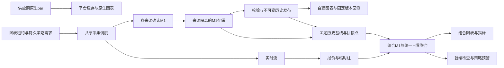

# 行情三层架构与实施方案

实施更新（2026-10-07）：完整A–E与Ubuntu真实环境实现验收已通过，
见[最终逐项核对](verification/three-layer/completion-audit.md)。长时间质量观察按用户最新决定暂缓。
本文原“待实施/待验收”叙述记录方案制定时的基线，具体交付以最终证据为准。

日期：2026-10-06。状态：产品方向与业务范围已确认；本文形成正式方案，新增能力待实施验收。
代码核对基线：`abb2030`，分支 `feat/market-data-integration`。

用户已认可综合分析建议，并要求形成方案。交接中的三个待答点现已确认采用建议：
明确保存实时来源映射及版本；首次实际使用第三层时幂等创建并共享；本阶段提供行情、
策略判断和预警，供人工交易使用。没有阻塞方案形成的业务问题。

本文是三层产品行为的当前依据，优先于旧接入方案与按需历史方案中的冲突条款。
旧阶段实现与质量证据继续保留，但不证明三层新增功能已经完成。
本次只形成文档；暂缓推送和PR仍有效，MT4实时接入延期，不包含模拟或真实自动下单。
交接前用户最新调整：当前不要求移动端兼容适配，UI以桌面浏览器为交付与验收对象；
后续会话接续开发，按本文阶段推进，不重新访谈已确认的业务选择。

2026-10-07验收范围调整：用户提出快速迭代期间实现验收后暂不进行质量观察。
当前交付收口以完整实现和真实Ubuntu功能、回归、并发及短时恢复验收通过为准；
不启动新三层48小时观察，不以长时观察作为本次完成门槛。核心链路稳定或准备发布时
再固定代码版本单独做质量观察；本次明确保留长期稳定性与增长容量未经长时验证的状态。

## 1. 产品分层

| 层级 | 用户用途 | 数据口径 | 维护方式 |
| --- | --- | --- | --- |
| 平台行情／原生系列 | 快速浏览、了解品种、核对来源 | 读取供应商对应周期原生bar，不自行重切OHLC | 按需请求与缓存 |
| 自建行情／回测历史 | 历史研究、固定版本回测 | 单一来源原始M1，按数据集规则派生周期 | 初次下载、定时增量、校验与发布 |
| 组合行情／混合源 | 策略、预警与人工交易辅助 | 固定自建历史接指定实时源确认M1，再加临时行情 | 首次使用创建，按有效需求维护 |

三层共用供应商客户端、请求预算、原始M1、聚合和指标模块，但保留不同身份与数据契约。
第一层缓存不是第二层的权威版本仓库；只有来源身份、请求口径和确认语义兼容的M1可复用。
原生高周期不能替代自建高周期。回测使用第二层；第三层审计用于复现实盘判断输入，
不扩展为另一种组合回测产品。

首批验证EURUSD、XAUUSD，保留Binance与Yahoo既有功能。目标支持3–10个活跃品种，
具体来源能力和性能以验收为准。

## 2. 领域对象与身份

| 对象 | 身份与内容 | 修改规则 |
| --- | --- | --- |
| 来源系列 | source、channel、environment、account_scope、准确provider_symbol、basis、影响结果的上游参数 | 口径变化建立新身份 |
| 自建数据集 | 来源M1系列、聚合规则版本；关联显示元数据与维护计划 | 日界等价格序列语义变化建立新身份；维护频率可调整 |
| 发布版本 | 数据集、固定区间、不可变分块、校验和、覆盖证据、派生规则及各周期产物 | 发布后不可变，新数据和修订产生新版本 |
| 实时映射 | 自建数据集对应的目标来源系列、产品匹配依据、映射版本 | 明确保存；更改不自动替换运行中的组合 |
| 组合定义 | 权限范围、自建数据集、映射版本、聚合与接续规则 | 同配置共享；配置改变生成新定义或显式新修订 |
| 组合修订 | 固定历史版本、拼接点、规则版本、启用时间及父修订 | 历史基线与拼接点不原位修改 |
| 使用需求 | 使用者、系列、周期、预热要求、新鲜度与期限 | 图表租约和策略持久需求分别维护 |

采集身份与派生身份在内部区分：同一来源M1可供不同日界数据集使用，不因日界增加上游连接。
现有`DatasetIdentity`包含calendar_version，作为旧显式身份保留；通过明确关联迁移，
不改写旧ID、Instrument.source、ticker、Bar归属或已发布manifest。

OANDA平台原生身份必须覆盖环境、账户范围、price、smooth、dailyAlignment、
alignmentTimezone、weeklyAlignment及周期等影响返回值的参数；当前固定配置也要规范化记录。
查询时间和分页游标属于请求范围，不为每次查询生成新系列。
凭据不进入公开身份；账户范围使用不透明标识，跨权限范围不共享受限结果。

品种映射不能只去掉下划线或斜杠：核对标的、报价币种、产品类型和价格口径。
现货、CFD、期货不默认等价。明确默认映射可以复用，无法确认时显示待配置。
首批目标实时源为OANDA practice，架构允许后续有合适能力的其他来源。

## 3. 数据流与模块职责

模块职责如下，复用现有PostgreSQL任务、租约及worker，不另建三套基础系统：

- 供应商能力模块：目录、原生周期、M1历史、确认柱、报价、覆盖限制和请求结果；adapter隐藏分页及协议差异。
- M1与发布模块：来源校验、修订、覆盖、分块、维护任务和不可变版本；调用者不自行拼下载流程。
- 聚合模块：按显式规则派生周期，输出覆盖与来源证据；平台原生路径不调用自建分桶。
- 组合模块：解析固定修订，读取M1分段、处理接缝与尾部修订，提供一致的图表和策略输入。
- 需求模块：合并图表、策略和常驻需求，映射实际来源，控制共享采集与恢复优先级。
- 策略模块：声明输入依赖，检查就绪，管理指标状态、事件水位与通知防重。

以小而完整的接口隐藏任务、租约、恢复和缓存细节；不要求图表、MCP和规则各自实现组合逻辑。

## 4. 第一层：原生系列

按供应商实际能力开放周期，直接使用返回OHLC，必要的时间标签转换保留来源时间含义。
不将本地聚合称为平台原生。Dukascopy需补原生adapter和能力验证，不能只加入来源枚举。
缓存键包含完整语义口径；平台不可用时可展示已缓存结果与陈旧状态。
可搜索表示来源目录可解析，不承诺该来源全部周期、历史范围或实时能力。

新来源按能力接入：只有原生bar能力即可进入第一层；有可验证的确认M1和历史范围才开放
第二层；第三层还要求明确实时映射、尾部确认与恢复能力。本地自建周期不受原生高周期列表限制。

## 5. 第二层：维护、派生与发布

数据中心提供添加、暂停/恢复、补数/重试、覆盖查看、归档与删除入口。
配置包括来源品种、价格口径、目标区间、资产类别、日界、所需周期和维护计划。
默认按日维护，时刻与来源数据可用性适配；任务创建时固定截止时间，不在执行中追逐当前时间。

流程：登记 → 下载/补数 → 校验 → 派生所需周期 → 发布。增量任务复查近期重叠窗口，
检测修订；只替换变化分块和受影响桶，其余复用。复查窗口长度可配置，有限窗口不承诺发现
任意久远修订，另支持人工指定范围复查。失败保留检查点与旧发布版本，不将旧版本下架。

外汇、金属默认America/New_York当地17:00，随DST转换；加密默认UTC00:00。
指数及未定义类别必须显式选择日界。按数据集可覆盖，修改日界形成新身份并复用原M1。
H4相位、周起点、周/月派生与DST规则全部版本化；首版复用现有已测试聚合规则，
不因来源切换隐式更改。周月柱必须使用同一规则口径。

覆盖分别保存实际观测、成功查询但unknown、请求失败、已证实闭市及证据冲突。
缺失不补价格、空响应不证明闭市。日界只决定分桶，来源会话证据只参与缺口与完整性判断。

M1发布不等于所有高周期发布。每个周期产物标明父M1版本、覆盖、构建规则和状态；
后续追加高周期产物只引用同一不可变父版本，不改写已发布内容。查询和回测固定完整输入清单，
不在一次读取中混用新旧发布。回测允许使用明确披露unknown的版本，具体策略对质量的要求另行校验。

## 6. 第三层：按需创建与固定接续

搜索没有创建或采集副作用。只有已有可用自建历史且映射有效时，才提供可建立的组合候选。
首次打开第三层图表或创建使用第三层的策略/预警时建立组合；查看第二层、运行回测不触发实时采集。

幂等键由权限范围、自建数据集ID、实时映射版本、聚合与接续规则版本规范化生成。
数据库唯一约束和事务保证并发请求共享同一定义与准备任务。历史发布版本和拼接点在首次准备时
原子固定；其后新发布版本不使同一请求生成重复组合。显式重建基线使用独立、幂等的修订操作。

拼接点T优先选取不晚于历史版本可用截止时间的最近配置日界，检查历史侧所需范围和实时源从T
到当前确认水位的可获取能力。不足时进入准备中或阻塞并说明原因，不前移T掩盖缺口。
非日界拼接只能作为显式规则的新修订，不在失败时自动降级。

- `[历史起点,T)`取固定历史发布版本；`[T,确认水位)`取目标来源确认M1。
- 两侧重叠用于核对；选择按T确定，不平均、不平移、不根据某次请求成功与否临时换源。
- 当前未确认分钟可由stream形成临时柱，REST确认后替换；采样流不证明分钟完整极值。
- 先接续M1，再按组合日界聚合。D1/H4与历史规则不兼容时须由M1重派生，不能直接拼高周期。
- 日界拼接仍可能穿过W1/MN，跨源桶必须保留分段来源与接缝标志。
- 若历史和尾部来自同一来源，复用对应存储，仍固定版本边界并处理修订；无需复制整条历史。

第二层每日发布不自动更新已启用组合的历史版本或T。换基线、改映射、改日界均产生新组合修订，
异步预热后在明确事件边界原子启用；记录旧/新修订、时间和原因，旧策略引用不静默转移。
确认M1尾部可以按既定策略接收供应商修订，但每次输入变化有独立数据修订和处理记录。
组合修订固定的是基线与规则，不将正在增长的尾部误称为整体不可变快照。

## 7. Bar、指标与策略契约

每根组合bar至少携带：UTC起止、OHLC、来源分段引用、组合修订、输入修订、
临时/来源确认状态、时间结束状态、覆盖质量、接缝标志及volume语义。
`time_closed`、`source_confirmed`和`coverage_complete`分别表达事实，不用一个complete代替全部含义。

单来源volume保留kind与unit；跨源或不兼容量语义的桶统一volume为空，分段原量可用于审计。
Dukascopy quantity与OANDA price_count不相加；stream消息数不替代官方volume。
即使单根都有量，跨来源窗口的量指标也必须检查兼容性，默认不开放不兼容窗口。

图表、指标与规则读取同一个组合输入解析结果。策略绑定规则版本、组合修订、周期、
价格口径、预热与覆盖要求、接缝处理政策、确认柱或报价模式。

首版策略默认使用确认柱；实时触价作为显式模式，披露采样流可能遗漏短暂触价，
断线不追认无法证明的事件。接缝前后价格不构成穿越事件；不自动消除价差。

价格指标可以使用组合历史预热，但必须声明是否接受含接缝的依赖区间。默认禁止跨接缝事件比较；
依赖跨源历史的指标策略在明确选择接受原价接缝影响前保持未就绪，不偷偷切成OANDA同源计算。
需要重新预热的策略遵循指标声明的初始化/检查点规则；不能用任意根数保证EMA等递归指标已消除影响。

报价可见、图表可读、周期已发布、指标已预热、策略可判断分别返回状态与原因。
策略门槛检查实际依赖区间、覆盖、确认水位、报价或收盘新鲜度以及接缝政策；
最新一根已确认不能证明整个预热区间已经修复。正常已证实闭市不机械按无报价时长判故障。

修订使受影响聚合和指标缓存失效；递归指标从修订点之前的有效检查点向后计算。
恢复顺序为补M1、重算、验证依赖、建立事件前态、恢复新事件判断。历史补数和修订默认不补发过期通知。
事件防重基于逻辑规则版本、系列、周期和事件时间，不以数据修订号绕过防重；
判定状态与outbox写入采用已有事务机制，重试不生成重复业务事件。
审计保留输入清单、规则版本、组合修订和当时读取的数据修订，后续修订不覆盖过去判断证据。

## 8. 需求、调度与资源生命周期

图表需求用可续期租约；启用的策略/预警使用持久需求；显式常驻配置单独计入。
暂停规则释放其主动需求但保留引用。关闭浏览器不能终止策略采集；保存但未打开的工作区不自动常驻。
最后一个有效需求消失且宽限期结束后停止对应主动采集，保留组合定义、历史和审计。
恢复使用时从确认水位补数并重新检查依赖，不能直接沿用过期ready。

同一账户/环境共享有效stream拥有者；需求按实际来源品种合并，多日界、多图表和多策略共享原始采集。
继续用租约、世代和事务检查拒绝过期拥有者发布。REST确认、恢复与历史任务共享来源预算，
确认/恢复优先，历史任务有公平性保障；429遵守冷却，401/403进入配置故障，不形成重试风暴。

初始图表租约可沿用30秒续期、2分钟宽限；确认时机沿用已有5秒保护与退避规则。
这些是工程初值，不是新SLA；以实际配置、并发测试及来源约束调整。

暂停第二层维护不停止第三层仍需要的尾部采集。删除分为停止维护、归档和物理回收：
先显示引用依赖；被回测、组合、策略审计或执行中的任务引用的数据不得回收。
共享分块按可达引用及保留规则回收，执行前再次检查引用与任务租约，防止并发创建引用后误删。
组合长期需要的确认尾部和审计修订是持久数据，不按平台短期缓存策略清理。

## 9. 搜索与数据中心行为

| 状态 | 搜索与使用行为 |
| --- | --- |
| 第一层来源品种可解析 | 可选择其支持周期；展示请求或缓存状态 |
| 第二层尚无发布 | 展示维护进度和入口，不作为已就绪历史 |
| 有旧发布但本次维护失败 | 保持可选，展示截止时间、延迟与错误 |
| M1就绪、H4待发布 | 分周期开放，H4显示准备中 |
| 第三层历史和映射具备 | 提供候选，实际使用触发共享准备 |
| 实时映射缺失或能力不足 | 显示待配置/不支持及原因，不猜测来源 |
| 组合尾部断线 | 保留历史和确认柱，分别显示报价、尾部与策略健康 |
| 图表可读、策略依赖不足 | 保持图表可读，相关策略等待或暂停 |

数据中心统一展示来源、口径、日界、维护计划、各周期可用范围、版本、覆盖证据、组合映射与引用。
UI与MCP复用业务接口。状态由后端计算，不能以屏幕宽度、前端按钮禁用或stream连通代替策略检查。

### 9.1 数据中心组织与交互设计

完整设计见[数据中心组织与UI设计](market-data-center-ui-plan.md)，作为本方案的配套实现与验收依据。
应用入口“行情接入”改为“数据中心”，保留原URL；设置“自建行情”（默认）、“平台品种”、
“组合行情”、“任务与记录”四个分区，来源状态作为次级入口。

自建列表以数据集为单位，展示来源/口径/日界、已发布范围、分周期可用性与维护状态；
详情拆为概览、覆盖与质量、发布版本、维护设置、组合与引用。创建流程为选择来源品种、
配置历史、核对并创建；改日界明确呈现为按新日界创建数据集。

组合页管理候选、映射、修订与使用健康，首次实际使用仍自动创建共享；浏览列表、详情和搜索不触发
实时需求。现有页面自动续订默认实时品种的行为须移除。平台、自建、组合搜索明确区分用途，
回测选择固定自建版本，新增策略选择组合并检查依赖；旧系列与旧策略保留原绑定。

维护失败与旧版可用同时展示，查询进度不当作数据完整率；暂停计划、暂停任务、归档、删除分别命名。
沿用现有应用外壳和视觉变量，桌面以列表/详情为主；配套文档包含桌面线框、
字段、异常、只读权限、桌面布局、可访问性与UI验收清单。当前不要求移动端兼容适配。
此为设计，尚未实现或进行新UI浏览器验收。

## 10. 现有实现复用与缺项

| 入口 | 可复用 | 必要改动 |
| --- | --- | --- |
| provider_capabilities/chart/cache | 原生周期、缓存、请求限额 | Dukascopy原生adapter、完整参数身份与能力说明 |
| market_contracts/datasets | 显式身份、来源校验 | 采集/派生关联、多来源兼容、组合独立身份 |
| history_versions/derivation/replay | 不可变M1、分块派生、固定回放 | 去除Dukascopy专用限制，接入OANDA发布、增量复用 |
| managed_dataset/publication_jobs | 图表发布、按周期状态、修订任务 | 与固定历史版本关联；屏幕就绪不作为策略门槛 |
| history_api/MarketDataPage | Dukascopy注册、可调日界 | 全源数据中心、维护生命周期与依赖展示 |
| domain/chart_aggregation | 日界、DST、周月聚合 | 组合来源分段、跨源volume及覆盖契约 |
| live_pricing/oanda_worker | 共享流、租约、确认与恢复 | 从组合需求解析实际来源，多派生共享采集 |
| chart_series/chart_api/business/service | 图表、MCP、规则与指标 | 新系列类型、统一组合读取、修订/就绪/接缝与防重 |

旧managed图表发布是可更新查询产物，HistoryVersion是固定回测输入，两者不能当作同一版本号。
迁移先建立映射与版本引用；来源不明的旧条目保持旧身份，不能猜测并收编。
十年回放已有同步预热411/439秒的证据；组合首次准备采用异步任务及可验证检查点，
普通读取使用周期索引和分段缓存，不逐次扫描十年M1，也不任意截短前缀改变指标结果。

## 11. 实施阶段与验收

以下阶段表示依赖顺序，不构成本次开始开发、推送或部署的授权。

| 阶段 | 交付 | 核心验收 |
| --- | --- | --- |
| A 身份与契约 | 能力、来源/派生关联、组合定义、状态及迁移设计 | 旧ticker和固定回测不变；同名不同口径不冲突 |
| B 多源第二层 | Dukascopy/OANDA注册、日更、覆盖、分周期发布；数据中心自建列表/创建/详情/任务 | 可恢复、修订仅产生新版本；暂停与旧发布可用；改日界不重下M1 |
| C 组合图表 | 明确映射、按需创建、固定接缝、共享采集与恢复；组合页及搜索联动 | 并发创建幂等；日更不移动接缝；跨源周月标记与volume正确；浏览管理页无采集副作用 |
| D 组合策略 | 统一输入、异步预热、门槛、修订与防重；策略输入与使用健康UI | 无跨源假穿越；断线后依赖完整再恢复；补数不发过期通知 |
| E 整体交付 | 原生Dukascopy路径、搜索/数据中心、兼容与质量报告 | 浏览器/MCP/策略一致；能力与状态真实；Ubuntu隔离验收 |

Dukascopy原生路径在A后可独立推进，不阻塞B至D的内部依赖。
每阶段至少覆盖正常、并发、失败恢复与兼容场景，重点验收：

1. 两来源原始M1独立；相同来源多日界共享采集；旧回测校验和不变。
2. 新维护失败不隐藏旧发布；M1完成不能提前开放未就绪H4；unknown不当闭市。
3. 多窗口并发只建一个组合/准备任务；第二层和回测访问不创建实时需求。
4. 日界、DST、周月跨源桶、量语义不兼容、拼接两侧缺口与供应商修订。
5. 新历史版本不自动替换组合基线；显式修订预热和原子切换；旧输入可审计。
6. 浏览器关闭后策略持续；全无需求后按宽限退出；重启后持久需求恢复。
7. stream活跃但确认柱缺失、确认柱存在但预热有洞、429/401、旧世代消息、两分钟断线恢复。
8. 接缝不触发假穿越；同事件修订/恢复不重复通知；图表与策略读取一致。
9. 被引用版本删除受阻；共享分块不误删；回收与新增引用并发安全。
10. 3–10品种、多图和历史维护并发；记录首次准备、缓存读取、确认和策略延迟及完整失败分母。

实现验收与质量验收分开。M1确认候选p95≤15秒、p99≤30秒沿用旧目标，需实测；
采样stream不承诺全tick、全瞬时触价或严格1秒。长期质量按实际开市、跨日、维护与恢复窗口记录，
48小时工程观察到期不自动判通过。按2026-10-07用户最新范围调整，本次暂缓启动，
不作为实现验收收口门槛；待核心链路稳定/发布准备时单独安排。原数据日历证据和测量限制继续披露。

## 12. 环境、证据与后续工作

开发、验证、验收仅在Ubuntu本机独立Compose project、网络、volume、数据库和端口进行。
unraid只用于另行授权的生产发布。清理只操作归属明确的资源，不全局prune。
验收交付记录实际运行主机、访问地址、启停命令、代码版本和结果，凭据及许可资源不提交。

当前已有观察实例及启动/停止方式见[运行手册](verification/data-integration/README.md)，
记录地址为`http://127.0.0.1:16589/market-data`。该实例是旧阶段观察环境；本文未重新检查其实时状态，
未部署abb2030或三层新功能，不能将旧观察结果当作新方案的长时验证。

下一步实施前完成技术清点：各adapter能力与实际历史范围、旧身份映射、发布模型迁移、
检查点算法、来源请求预算、磁盘与保留容量。日更时刻、重叠复查窗口、宽限时间、健康阈值和
缓存大小由实现依据实测确定，不需要重新访谈已确认的三层用途。若未来需要模拟/真实执行或MT4，
另行扩展范围。

关联资料：[原接入方案](dukascopy-oanda-market-data-plan.md)、
[实施记录](market-data-integration-progress.md)、[可调日界](verification/data-integration/configurable-aggregation.md)、
[旧阶段实现验收](verification/data-integration/implementation-acceptance.md)、
[旧阶段质量验收](verification/data-integration/quality-acceptance.md)。
