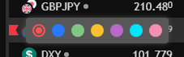

# 浏览器标签与自选表彩色收藏：方案分析

日期：2026-10-17。应用源码基线：`99124bb`。本次为 P0 分析与文档；未实施动态标题、彩色收藏或正式登录改版。登录视觉已另行[确认并留档](../design/login-approved-20261017/README.md)，整体入口与导航见[主方案](single-app-routing-navigation-proposal-20261017.md)。

结论：浏览器标签可由现有宿主与行情链路补齐；彩色收藏按用户截图的行内旗标和七色色板设计。TradingView 官网确有该控件，但本项目当前实际加载的 **TT v31.1.0** 中，相关旗标动作是空实现，独立运行也未出现旗标或色板，不能当作“打开一个已知参数即可启用”的功能安排。

## 用户参考与目标

| 参考 | 目标 |
| --- | --- |
| [浏览器标签截图](native-chart-tab-watchlist-20261017/browser-tab-reference.png) | 当前查看品种、最新价格、日涨跌百分比，例如 `SPX 7,659.44 ▼ −1.09%`。 |
| [自选表截图](native-chart-tab-watchlist-20261017/watchlist-flags-reference.png) | 保留原生自选表、分组及行情列，在品种行左边显示收藏旗标。 |
| [颜色菜单截图](native-chart-tab-watchlist-20261017/watchlist-color-palette-reference.png) | 点击旗标选择红、蓝、绿、黄、紫、青、粉；可更换颜色或取消标记。 |

这里的“收藏”包含颜色。普通列表成员关系不能替代它：品种可同时在多个普通自选表中，收藏颜色应保持一致；从普通列表移除品种，不应顺带删除收藏标记。

## 浏览器标签：由顶层应用更新

用户已确定：浏览器标签左侧使用**当前守望 Logo** 作为 favicon，复用[已确认登录页](../design/login-approved-20261017/README.md)的品牌图形，全站保持一致。

用户已确定标题格式：`SPX 7,659.44 ▼ −1.09%`，仅显示品种、最新价和日涨跌幅，不附加“守望”或其他产品名称。上涨使用 `▲ +…%`，平盘不显示方向箭头。浏览器标题是纯文本，不能像页面内容一样分别给价格或百分比着色。

现状依据：

- [网站入口](../../web/index.html#L1)的标题固定为“守望 · Market Watch”；[图表宿主页](../../advanced-host/index.html#L6)另有 iframe 自己的标题，目前没有应用级 `document.title` 更新逻辑。
- 专业图表使用[隔离来源与消息桥](../../web/src/advanced/AdvancedWorkspace.tsx#L94)。iframe 的 `title="专业图表工作区"` 是可访问名称，不是浏览器标签标题；只修改 iframe 文档的标题也不能替代最外层网页标题。
- 现有图表已订阅[激活图变化](../../advanced-host/bridge.js#L198)及[主品种/周期变化](../../advanced-host/bridge.js#L2067)。报价走[现有 getQuotes / subscribeQuotes](../../advanced-host/bridge.js#L887)，缓存由 `quoteSnapshotRows` 管理；[后台报价](../../backend/alerts/market_data.py#L1052)已经提供 `lp`、`ch`、`chp`、`prev_close_price`。

建议在现有桥上新增“当前激活主图及其报价”消息，由 React 父宿主更新 `document.title`。保留当前[origin、source、channel 校验](../../web/src/advanced/AdvancedWorkspace.tsx#L254)，并检查 ticker、工作区/实例代次及数值有效性。图表来源不直接访问顶层 DOM，也不另行拿网站凭据或建立报价接口。

| 场景 | 建议规则 |
| --- | --- |
| 多图布局 | 跟随用户当前激活窗格的**主品种**；切换激活图时取消旧监听，绑定新监听并立即更新标题。 |
| 切换品种、工作区或供源 | 立即显示新主品种；报价返回后补价格和百分比。按完整 ticker 与当前实例代次丢弃迟到的旧报价，不能把上一品种的价格挂到新名称下。 |
| 鼠标查看历史 K 线、增加比较线、只改变自选表高亮 | 只有真正改变激活主图品种时才切换标题；十字线的历史价格不进入标签。 |
| 日涨跌 | 复用与原生自选表相同的报价口径；不按当前 5 分钟/小时 K 线重新计算。组合品种沿用现有 NY17 / 上一确认 D1 口径。 |
| 当前主图不在自选表、右侧自选表关闭 | 仍要能取得主品种报价；复用现有订阅管理，必要时为该 ticker 增加一个逻辑订阅并按需复用，离开图表后释放。 |
| 最新价或前收缺失 | 没有价格时只显示品种；有价格但无日基准时省略百分比，不编造 `0.00%`。 |
| 固定历史或供源迟延 | 标明“历史”或可确认的迟延状态，不把历史尾价当实时。 |
| 通知、设置、登录等页面 | 改为“通知”“设置”“登录”等页面名称；销毁图表监听，避免残留行情覆盖。 |

持续报价更新最多每秒写一次标题，品种和激活图变化即时写入；相同文本不重复写。使用当前品种的精度/价格格式。标题能力不增加任何导航栏，也不占图表面积。

官方依据与界面/API区别见[官方能力核对](native-chart-title-watchlist-official-facts-20261017.md)。本次未查到当前版本公开的自动修改浏览器标签开关，因此将这项行为明确放在顶层应用。

## 原生自选表：已有能力继续使用

项目已经在[构造参数](../../advanced-host/bridge.js#L2166)启用原生 Watchlist、Details、Data Window，并在[watchlists.js](../../advanced-host/watchlists.js#L1)中使用 `widget.watchList()` 保存多列表、分组、成员顺序和当前列表。数据写入用户偏好 `mw.watchlists.v1`，与具体工作区布局分开。

这些能力继续复用，保留已有自选表布局、列和价格显示适配。彩色收藏只补品种级的标记语义，不重新做一个 React 自选表，也不把现有列表数据迁移一遍。

## 彩旗：官网有，当前嵌入包中未形成可用控件

[TradingView 官方彩旗说明](https://www.tradingview.com/blog/en/flagged-lists-improved-9521/)确认：官网可点旗标选色，每种颜色对应动态列表，同一品种使用一种旗标颜色，也支持右键改色。该文是 2018 年的五色版本；本次按用户提供的七色截图确定需求，不引用其历史订阅限制来推导当前嵌入版。

为避免仅凭类型声明下结论，本次进一步只读检查入口、实际加载组件，并单独运行本地 SDK：

| 证据 | 本次结果 |
| --- | --- |
| 实际版本 | 运行 `TradingView.version()` 返回 `TT v31.1.0`，internal id 为 `6b804c486857f27920cf761aa7eb6e29d9bb6362`，与现有[自选表适配器的版本约束](../../advanced-host/watchlist-layout.js#L6)相同。 |
| 实际加载路径 | 入口加载 `runtime.d6871abde1090b0329fe.js`、`library.e2f8b3a016c9e1a0b7a5.js`；Watchlist 为 `watchlist-widget.f2884e5a3090b7d69890.js`。四份文件的 SHA256 均与仓库[许可库清单](../../advanced-host/library-manifest.json)匹配，不以目录中其他同名旧组件作结论。 |
| 组件功能 | 对应单品种和多选旗标动作返回空数组，清除旗标动作返回空值；旗标相关 hook 没有绘制/选色逻辑，列定义也未构造旗标列。包中残留的 `flag` 样式和 `flaggedSymbolsColors` 快捷键埋点，不能证明控件可用。 |
| 当前配置/API | `watchlist_settings` 公开项只有默认品种与只读；`IWatchListApi` 管理列表和成员，没有颜色读写接口。应用没有配置一个已知的“禁用彩旗”项。`items_favoriting` 处理常用周期/指标/绘图等，与品种彩旗不同。 |
| 运行检查 | 以项目使用的 `zh`、`readonly=false` 加载原生自选表，三行报价正常。行内旗标节点和颜色菜单均为 0；右键只有添加品种及加入比较等操作，`Alt+Enter` 后也没有色板。无页面错误、请求缺失或控制台警告。 |
| 核对边界 | 运行使用确定性模拟 K 线/报价及内存设置，不连接应用后台，不读取账户，不保存会话或更改库文件。它证明当前本地组件行为，不是完整应用端到端回归，也不代表所有 Trading Platform 版本。 |

运行截图：[原生自选表](native-chart-tab-watchlist-20261017/native-watchlist.png)、[右键菜单](native-chart-tab-watchlist-20261017/native-watchlist-context.png)；版本、加载文件哈希与观测结果见[证据 JSON](native-chart-tab-watchlist-20261017/runtime-evidence.json)。许可库不复制、不提交。

因此，**官网有这个原生控件，但当前项目这份嵌入包不能按“只改配置即可出现七色色板”承诺交付。** 完整官方公开文档及最新 release notes 也未确认启用项；不能反过来承诺“升级到最新就一定有”。

## 推荐的收藏实施路径

优先选择 TradingView 支持的原生路径：核实可用产品/版本是否提供 Watchlist symbol color flags、公开启用项、颜色事件及存储接口。如果拿到受支持组件，直接复用其旗标与色板，并通过现有设置适配器接入账户偏好；无需改变图表布局。此处仅记录核实事项，未向厂商发送消息，也未假定存在可用升级包。

在确认原生路径不可用、仍使用当前版本时，若要交付截图交互，建议做一个**独立的品种旗标模块**，复用现有自选表，仅在品种名左侧增加小旗入口和浮层色板。不要修改许可库，也不要使用供应商私有状态伪装成已支持的原生功能。行内接入如必须使用供应商 DOM，须像现有布局适配一样锁定当前版本、识别行的完整 ticker；遇到不支持的版本停用这项增强，不影响原生列表。它有明确的版本维护成本，不能称作零成本原生开关。

建议的行为与存储边界：

- 一个品种可为红、蓝、绿、黄、紫、青、粉之一，或不标记。点击小旗打开色板，标出当前色，提供明确的“取消收藏”；颜色有文字名称、键盘操作与焦点恢复。
- 同一完整 ticker 在不同自选表中始终显示同一颜色；按供源和序列的规范身份区分同名品种，不用裸 `EURUSD` 或易变的行号作为键。
- 收藏属于用户偏好，跨工作区保留；建议使用独立 `mw.symbol-flags.v1`。不要把颜色塞进 `mw.watchlists.v1` 的品种字符串或每个工作区布局。复用现有偏好 API、revision 与错误反馈，刷新/重新登录后恢复；不因此承诺跨设备实时推送。
- 从普通自选表移除品种、删除普通列表或切换工作区，均不清除该品种的收藏颜色。清除收藏仅删除旗标关系。
- 旗标点击不触发原生行的品种切换/拖动；滚动复用行时重新按 ticker 绑定，避免颜色串行。只调整品种行内部的小图标位置，不增加顶栏、导航或改变右侧面板宽度。
- 按颜色聚合时，颜色视图应由品种标记实时派生，不建立七份需要用户重复维护的普通列表。具体接入原生列表菜单的可行性另行验证；第一步先完成行内选色、取消和持久化。

## 后续验收

动态标题须覆盖多图焦点、快速切换品种/工作区、主图不在自选表、历史十字线、缺前收、固定历史和离开图表后的标题恢复。收藏须覆盖七色选择、改色/清除、跨普通列表一致、同名不同供源、虚拟列表滚动、刷新恢复、偏好保存失败/冲突、键盘和手机只读边界。

本次已完成文档及当前 SDK 的独立运行核对；后续实现时再执行对应应用回归。保持已认可的图表布局与汉堡导航，菜单不重复放数据中心，图表现有数据中心按钮继续使用。

本轮 P0 的理由是变更仅含 Markdown、截图和核对结果，最小检查为文档引用/本地链接、JSON、diff 格式及本人自审。后续动态标题可按兼容前端变更 F0 验收；收藏如引入 `mw.symbol-flags.v1` 新持久格式，应按 F1 重新评估并补颜色数据的保存、恢复与并发兼容验证。
