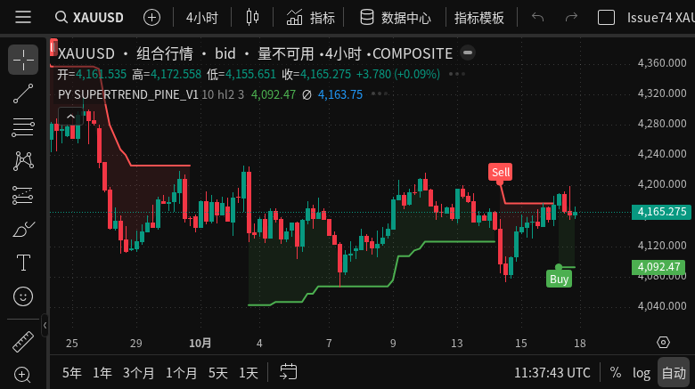

# 真实 XAUUSD 两个月组合行情与添加指标闪空

2026-10-17。运行主机 Ubuntu `quant-server`，独立 Docker project `mw-issue74-20261017`。
本增量完成真实历史组合准备和平台凭据过期的闪空修复；Issue #74 整体验收仍未通过。

## 人工测试入口

- 应用：`https://127.0.0.1:18474/advanced-charts`，图表 origin：`https://127.0.0.1:17475`；两端口均需转发。原登录凭据不变。
- 管理布局 → `Issue74 XAUUSD 近两个月组合行情 20261017`。
- 布局 ID `671ce132-b00a-4fb6-b0f1-d47702c30634`，保存 revision 2 已核对采用下列 v2 组合。
- 搜索 `XAUUSD`，选择描述 `Issue74 XAUUSD 近两个月（真实组合验收） · 组合 · dukascopy→OANDA Practice · bid · ny17`。
- 图表镜像 `market-watch-chart-origin:issue74-credential-v5`，实际 ID `sha256:bad45f7c9ac4e057a7cd48c317af359ce2f46891b2fdb543cc2763982563b03e`。未发布生产。

## 数据来源与边界

通过实际 Dukascopy SDK 4.0.1 导入 XAU/USD Bid M1，查询区间 `[2026-08-17 00:00, 2026-10-17 00:00)` UTC，共 **61,828 根真实观测**，没有生成或补造价格。
M1/M5/M15/M30/H1/H4/D1/W1/MN 九个周期已发布。NY17 是聚合相位。

初版缺少来源会话规则，H4 每日停盘对应的桶保持 incomplete，Supertrend 预热不断被打断。
这次没有改写该已发布版本：保留它作为诊断候选，暂停它的维护，并建立新的日历身份。
按 Dukascopy 官方 XAU/USD 常规时段核对，采用纽约工作日 17:00–18:00 暂停、周五 17:00 至周日 18:00 暂停。
全部 61,828 根原始观测均未落入这些常规闭市区间。
新版本逐块复用并验证旧版本的不可变原始观测，保留原始 checksum 和派生 provenance；没有用较新的 staging 价格替换历史。

来源规则仅在 **2026-08-17 至 2026-10-18 UTC** 的有限审核区间有效。
官方普通时段、全量观测不冲突和公共 JSON3 feed 的边界/SLA 是不同证据；本次不认证后者，也没有将未知节假日例外标为完整。
原始常规时段网页的 SHA256 与摘录保留在 `dukascopy-regular-session-evidence.json`。
H4 270 根中 267 根 complete，D1 45 根中 42 根 complete；剩余缺口/边界仍保留。
后续日期使用前应继续审核来源会话适用范围。两个月 H4 不足 500 根，不能用它要求 EMA500 必须有值。

| 对象 | ID |
|---|---|
| 来源会话明确的数据集 | `876dea0322a7af95954ef967ccf66fc05b26dd1cc8026499d7f60dab3a90cf65` |
| 固定历史版本 | `e58c153b-1a3a-4aaa-a8c1-eddbbf1576fd` |
| 组合 | `f6b3e47945a87094bb0ad5c1ee442c4f9d52cd55a2b0961e041b5945b2051c74` |
| 组合修订 | `4c75713d-ed9e-4bfe-800f-cedf25975347` |

拼接点固定为 **2026-10-16 21:00 UTC**，此前属于 Dukascopy 固定历史，此后属于真实 OANDA Practice `XAU_USD` Bid。
映射明确记录两家经纪商/产品不同，不假设它们的价格完全相同。
用户授权从生产只读取得 OANDA 配置；只写入本任务隔离实例，未改变生产服务。
保留本任务原有通用代理设置，OANDA 使用自己的专用代理与实际生产采用的 `rest_batch` 模式。
配置、token、账户原文、代理地址和 compose 均不归档。

当前为周末。真实 OANDA 目录请求成功，接续供应商查询成功但返回 0 根，preparation 为 `queried`、`input_revision=0`、`confirmed_end=0`。
**成功空响应不证明完整覆盖**；本次没有开盘后的真实接续或跨经纪商接缝数值验收。
历史维护配置为每日 UTC 00:30、复查最近 2 天，固定起点为 8 月 17 日；没有自动滚动删除旧数据。
本任务补齐 history、composite-aggregate、chart-history、market-stream 和 OANDA 采集 worker，每个上限 0.5 CPU/384 MiB，复用本任务 PG。其他任务和旧 fixture 保留。

## 实际 Playwriter 检查

真实组合 H1、M15、H4 均出现 Supertrend 的有限趋势线值，H4 period 10→14→10 成功采用当前参数。
独立布局保存后刷新，主系列仍为正确组合，Supertrend 最新值一致；刷新前后加载的可见/储备行数不同，**不声明可见数组严格相同**。
`composite-reload-final.json` 明确保留 `sameVisibleRows=false`、`sameLast=true`。
此处为功能检查；导入、派生或构建期间的观察不充当延迟预算/p95 证据。



## 闪空的红/绿循环

普通添加指标的健康对照没有主图重载。随后让独立测试页的一次指标请求携带实际已过期的 provider 展示凭据；服务器真实返回 HTTP 422 `DISPLAY_SNAPSHOT_EXPIRED`，未改行情或供应商输入。
原恢复链为 `indicator coordinator → recoverDisplaySnapshot → reloadHistory → refreshChartHistory → chart.resetData()`。
Native 内存中的 bar 数量可以仍大于 0，但绘制已经清空，因此仅检查 `data().size()` 会漏检用户看到的闪空。

前台页面在原生主画布逐帧统计 K 线红/绿像素，排除顶部图例；最低值小于同次基线 15% 即失败。
同一红色脚本已实际运行并报告：

```text
flash-canvas.playwriter.js
baseline=11946, min=0, frames=378, blank=true
RED: existing candle paint disappeared during expired-snapshot recovery after adding indicator
```

零像素共 34 帧，首尾相差 552 ms。画布/样式和来源变化会影响像素总数，此断言是本场景的闪空回归，不是通用视觉或性能 oracle。
过期恢复日志也在一次未注入的界面添加操作中捕捉到，但该次当时尚未前台逐帧采样；不将其冒充完整视觉证据。

最小修复：平台恢复先有界重读纯价格页，要求 cache revision 相同，并逐根核对所有已加载 native 主系列的时间、OHLC 和量；重读期间还需保持工作区、品种和已接受数组不变。
完全一致才安装新展示凭据，保留计算起点和主图；如果版本/价格/量改变、范围不完整、读取失败或无法核对，则继续原有完整恢复。
较新实时凭据已被接受时，迟到的旧恢复不会再重置主图。
组合恢复路径未改。此补丁不声称消除了所有历史更正、品种切换或周期切换时的重载。

| 检查 | 注入过期、真实 422 | 画布基线 / 最低 | 采样帧 | 主图 reset | 指标覆盖 |
|---|---|---:|---:|---:|---|
| 旧镜像最小复现 | 是 | 11946 / 0 | 378 | 触发 | 恢复后有 |
| 旧镜像健康对照 | 否 | 9097 / 9097 | 393 | 无 | 有 |
| v5 LWMA | 是 | 8793 / 8664 | 371 | 0 | 有 |
| v5 界面添加 Supertrend | 是 | 8664 / 8664 | 426 | 0 | 有 |

v5 冷开平台图时，另有窗口历史请求在周末尾段反复超时；没有把它改判为指标失败，也没有在此扩展窗口获取优化。
为独立检验“已有 bar 后添加指标”，只在原生主系列已经接受真实价格后启动画布断言。
设置脚本曾预备一个限定历史截止的路由，但实际未匹配 native_history 请求，也没有产生请求改写文件；**未改写请求范围或行情**，随后卸载该路由。
脚本与路由未生效的状态记录均归档；红/绿的过期处理使用真实 API。
修复前后 viewport/已加载行数不同，不声明相同输入的耗时对比。
两次候选预运行未触发过期：一次错误地位于组合图，一次平台 bar 尚未加载；均判为无效，未纳入表内，诊断文件留在任务临时目录。

## 回归、风险和余项

此补丁 **F0**：兼容的浏览器恢复逻辑，无 schema/持久格式变更；采用 Node 回归与 Ubuntu 真实浏览器 R1。
`web/tests/provider-credential-recovery.cjs` 先在旧 bridge 红色失败，再通过修复；覆盖同价格无 reset、价格/量/版本改变、缺失凭据/版本、范围不完整、期间换页、工作区/品种切换与较新实时凭据。
现有恢复生命周期、指标快照、重试失败、共享读取、组合显示批处理，以及 provider/composite 高频 bridge/coordinator 检查通过。新检查已纳入 CI。
原生代码未保留诊断探针；自己的 Playwriter observer/路由在结束时卸载，独立闪空页关闭。组合布局留给用户。

最近完成的全套 CI `39026587111`（本补丁前 `e287be4`）依然为 Backend **10 failed / 2560 passed / 11 skipped**，Web/Compose 通过。
本次不清零这些失败，也不宣称解决 EMA500 旧起点重新初始化、开盘实时接续、其他品种切换闪空或 Issue #74 全部验收项。
窗口历史获取速度仍不在本轮优化范围。后续应将凭据续期与需要重建主系列的真实价格更正保持为不同恢复步骤。

任务服务启停（私有 compose 不提交）：

```bash
docker compose -p mw-issue74-20261017 -f /tmp/mw-issue74-20261017/compose.json start
docker compose -p mw-issue74-20261017 -f /tmp/mw-issue74-20261017/compose.json stop
```

原始数据准备、浏览器报告/脚本和公开来源摘录的 SHA256 见 `manifest.json`；复制时逐文件核对源与归档一致。未合并、未创建正式 tag、未发布生产。
