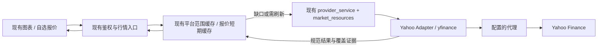

# Yahoo / yfinance 原生行情接入方案

日期：2026-10-03。状态：需求澄清完成，具体设计已形成，尚未实现。本轮交付为本文，代码、数据库与运行环境尚未变更。

设计基线：主仓库 `main` 的 `5dd196e`，项目版本 `1.5.2`，当前 schema 为 `p17_volume`。已有平台取数与缓存规则见[后端缓存与预热方案](provider-fetch-service-proposal.md)，数据系列约束见[双数据系列使用说明](chart-dual-dataset-user-guide.md)。本文针对 Yahoo 新源细化规则，不覆盖既有供应商的交易日切、九周期能力和自建维护规则。

## 1. 已确认的交付范围

首期用于简单查看行情：查看历史图表、现有图表指标和延迟报价，能够通过中文名称辨认品种。

| 项目 | 确定规则 |
|---|---|
| 数据源与客户端 | 新增 `source=yahoo`，由 Python `yfinance` 访问 Yahoo Finance |
| 标的范围 | 指数、ETF、美股、外汇、商品期货，以黄金和原油为重点；不纳入 A 股和港股股票 |
| 网络 | 行情、报价、搜索、元数据默认走后端配置的代理 |
| 数据线路 | 使用现有平台原生行情、调度和缓存线路；各周期直接向 Yahoo 获取 |
| 周期 | 仅 M1、M5、M15、H1、D1、W1、MN |
| 延迟 | 接受 COMEX、NYMEX 当前公布的 30 分钟延迟，页面明确标识 |
| 复权 | 美股与 ETF 开启 Yahoo 自动复权；指数、外汇、期货保留供应商 OHLC |
| 修复 | 所有标的均关闭 `repair` 和 `back_adjust` |
| 中文 | 常用品种中文别名，并保留原始代码、英文名、交易所、币种 |
| 后续实施范围 | 行情接入、图表、报价及现有指标输入；不实现策略、回测、买卖信号引擎或预警模块 |

不扩展项目周期集合。Yahoo 的 M30 和 H4 不开放：前者会被 yfinance 从 M15 重采样，后者没有直接接口；2 分钟、90 分钟、5 日、3 个月等当前项目未支持的周期也不纳入。Yahoo 品种只提供平台系列，不创建对应自建系列或历史维护计划。

## 2. 七周期映射和价格口径

| 项目周期 | 图表 resolution | Yahoo interval |
|---|---|---|
| M1 | `1` | `1m` |
| M5 | `5` | `5m` |
| M15 | `15` | `15m` |
| H1 | `60` | `1h`，兼容 `60m`，缓存只保留一个 H1 身份 |
| D1 | `1D` | `1d` |
| W1 | `1W` | `1wk` |
| MN | `1M` | `1mo` |

供应商支持集合是上述七周期；具体标的和周期还要区分「可获取」「无该周期数据」「暂时请求失败」。一次空返回或限流不足以永久关闭某周期。前端菜单、后端请求校验、订阅和预热必须使用同一份源能力信息。

美股、ETF 请求明确传入 `auto_adjust=True, back_adjust=False, repair=False, actions=True, prepost=False, rounding=False`；指数、外汇、期货改为 `auto_adjust=False`，其他参数相同。首期不提供复权切换器，也不自行构建复权因子或期货换月调整体系。

自动复权只调整所选周期的 OHLC，日、周、月仍分别获取原生数据。Yahoo 自身的股票 OHLC 通常已有拆股调整，因此非自动复权口径标为「Yahoo 供应商价格」，不能标为「完全不复权的历史成交价」。日、周、月采用供应商各自提供的复权因子，不承诺跨周期严格一致。作者记录过 Yahoo 周/月分红调整问题；本方案接受这一上游限制，保持 `repair=False`，避免改取日线再合成。

yfinance 的正常时区整理、去重、末尾 live 行合并属于客户端标准整理。本文的「原生」指直接获取目标周期，不保证 `history()` 与 Yahoo 原始 JSON 逐行逐值完全相同。不得用项目分桶、缺口填造或较小周期重采样补出 Yahoo 未提供的 bar。

## 3. 接入现有后端调度

继续使用 `provider_cache` 的 PostgreSQL 范围缓存、数据集租约、generation、短事务提交和 revision，使用 `provider_service` 管理活动、有限预热、最新尾部更新和 SSE；源级预算由 `market_resources` 统一约束。浏览器继续通过现有桥接入口取数，不直接访问 Yahoo，也不运行 yfinance。

### 3.1 模块与 Interface

新增一个小型 `provider_capabilities.py` Module 集中声明真实存在的源差异。其 Interface 提供：支持周期、SDK 操作并发/节奏、历史请求窗口、刷新间隔、对齐与负载版本、报价能力。调用方不再把「不是 OANDA」解释为 Binance。

新增 `provider_yahoo.py` Adapter，在既有取数 Seam 上提供三项能力：

| Interface | 输入与输出 |
|---|---|
| `native_page(meta, frame, before, count, deadline, optional)` | 对接现有缓存读取契约；返回规范 bars、查询覆盖、边界类型及证据，保留 exclusive `before` |
| `quote(meta, deadline)` | 返回市场价、供应商行情时间、抓取时间、同口径前收盘价及可用的延迟信息 |
| `search_metadata(query, deadline)` | 提供有限搜索结果及选中标的的类型、交易所、时区、币种、原名；中文覆盖由本地目录处理 |

SDK 会话、cookie/crumb、目标周期映射、按日期请求、客户端标准整理和 Yahoo 错误转换集中在 Adapter 的 Implementation 内。它不负责创建永久维护计划、图表重采样或遍历全部品种。对外结果必须区分短历史、休市空窗口、窗口限制与请求失败。

现有 `provider_chart.metadata/native_page` 保留为兼容入口，按 source 分派；`provider_cache` 保持统一读取 Interface。Yahoo 使用 yfinance 支持的会话类型，不能直接传入现有 `httpx.Client`。OANDA/Binance 的 httpx 连接维护继续使用现有 `provider_transport`；Yahoo 的 SDK 会话生命周期纳入该层的源分派，不照搬既有 HEAD 保活方式。

### 3.2 对现有调度的具体调整

1. `provider_service` 当前按固定九周期生成目标，且有按九项切片重排两轮目标的代码。改为按 source 构建目标并按轮次组合，Yahoo 只生成七周期任务，不能只删两个周期而保留九项切片。
2. Yahoo 沿用当前周期优先、先完成直接需求后预热的顺序。其余周期使用既有顺序过滤后的 `D1 → W1 → M5 → M1 → MN → H1 → M15`，达到可获取历史边界即停止该目标。
3. `provider_cache` 的页容量、最新新鲜度、近期尾部判断及历史探测使用源策略。Yahoo 按日期范围读取，不沿用 Binance 的「不足 1000 根等于结束」。
4. 启动注册、`_ACTIVE_READS`、槽位、warm/live worker 和 executor 容量按真实源集合配置。新增 Yahoo 会话/任务使用现有服务生命周期，数据库连接预算不因新源增加。
5. Yahoo 的报价请求也由后端调度与源预算控制。浏览器现有轮询可以保持，但上游刷新是否到期、请求合并与退避由后端决定。

## 4. 首版默认参数

以下为方案默认值，实施时可在真实限流和时延证据下调整；不是 Yahoo 官方配额或已验收性能。

| 参数 | 首版建议 |
|---|---|
| 启用开关 | `ALERTS_YAHOO_ENABLED`，实现交付时显式启用 |
| 代理 | `ALERTS_YAHOO_PROXY` 优先，否则使用 `ALERTS_MARKET_PROXY`；没有代理时报明确配置错误，不静默改直连 |
| Yahoo 操作并发 | 每个 API 进程 SDK 操作单并发；跨进程源预算继续通过现有资源预约约束 |
| 源级节奏 | SDK 操作启动间隔初始至少 1 秒，各优先级共享该源节奏 |
| 报价和活跃图表尾部刷新 | `ALERTS_YAHOO_POLL_SECONDS=60`，缓存 freshness 同步使用该值 |
| 元数据有效期 | `ALERTS_YAHOO_METADATA_TTL_SECONDS=86400` |
| 搜索 | 最多 20 项，已知 query 结果短期缓存 5 分钟；空 query 只列本地目录 |
| 基本窗口、深度目标 | 沿用当前可配置基本窗口和 4000 根深度目标；受本次实际需求、源历史窗口和现有容量上限共同限制 |
| 活动、订阅和缓存保留 | 沿用现有租约、停止规则、缓存保留期和全局容量上限 |
| 时间预算 | 沿用现有请求 deadline；SDK timeout 使用剩余预算，认证与元数据开销也计入 |

单次前台请求超时应结束等待并显示可重试状态；SDK 的多次内部 HTTP 请求不能因每次重置 timeout 而无限延长。现有短数据集租约必须覆盖允许的单页操作，或者采用有 generation 约束的续租；失效租约的结果不能写库。

一个 SDK 操作可能包含多个 cookie/crumb 或行情 HTTP 请求，以上并发/节奏约束的是 SDK 操作，不能宣传为精确的 Yahoo HTTP 配额。前台请求和活跃尾部高于预热，低优先级任务按页让位。前台取消不继续扩展历史；已发出 SDK 操作有界结束，其共享结果是否可提交仍由租约与 generation 判断。

429 使用源级冷却，优先遵从可获得的 `Retry-After`，否则从 60 秒指数退避到最多 15 分钟；同源其他任务共享冷却，不能每图各自重试。403、认证、代理错误单独报告并使用有界重试。网络失败不产生成功覆盖或历史结束标记。

首期报价采用请求驱动的短期缓存和在途合并，由现有调度层安排过期刷新；不增加独立常驻报价服务或 WebSocket。进程内缓存不宣称跨 API 进程共享，跨进程仍受数据库源预算控制。

## 5. 品种目录、中文名与稳定身份

复用 `MarketCatalog`，新增一列 `metadata_json` 保存英文原名、Yahoo quoteType、真实交易所、币种、交易所时区、会话资料、支持周期、复权模式和目录更新时间。通过一条正式 Alembic 迁移新增 JSON 默认值，迁移从实施时实际 head 派生；不为 Yahoo 创建新的行情数据库。

目录分成预置常用品种与按需搜索扩展。预置名称由本地小型配置维护，Yahoo 名称保留为补充：

| 代码 | 中文名 | 类型 |
|---|---|---|
| `GC=F` | 黄金期货 · COMEX | FUTURE |
| `CL=F` | WTI 原油期货 · NYMEX | FUTURE |
| `SI=F` | 白银期货 · COMEX | FUTURE |
| `^GSPC` | 标普 500 指数 | INDEX |
| `^DJI` | 道琼斯工业平均指数 | INDEX |
| `^IXIC` | 纳斯达克综合指数 | INDEX |
| `SPY` | SPDR 标普 500 ETF | ETF |
| `QQQ` | Invesco 纳斯达克 100 ETF | ETF |
| `AAPL` | 苹果公司 | EQUITY |
| `MSFT` | 微软公司 | EQUITY |
| `EURUSD=X` | 欧元／美元 | CURRENCY |
| `GBPUSD=X` | 英镑／美元 | CURRENCY |

`GC=F` 的当前英文名可能带实际合约月份，需保留，例如本次返回 `Gold Dec 26`。该代码与 OANDA `XAUUSD` 是不同标的，分别保存与显示。本文不定义 Yahoo 期货换月或连续合约调整规则。

搜索先查本地代码、英文名和中文别名，再对非空 query 作有限 Yahoo 搜索；不在每次输入时扫描全市场。新股票必须确认属于美股范围，A 股和港股股票不进入目录；不能因名称搜索命中就忽略类型与交易所过滤。Yahoo Search/Lookup 不是完整市场主数据目录。

当前 `chart_series` 只接受 `[A-Za-z0-9:_-]` 且长度最多 40，不能直接作为内部 ID 使用 `GC=F`、`^GSPC` 等代码。先用 Yahoo 返回的规范 symbol 统一大小写，再采用 `YAHOO:` 加该 symbol 的 SHA-256 前 32 个十六进制字符作为稳定 ID，长度 38；建目录时校验同 ID 对应的 raw symbol 一致。原代码单独保存在 `MarketCatalog.symbol`，传给 SDK 时保持原样。

图表 ticker 继续使用 `MWP:{内部ID}`，前端通过元数据展示原始 symbol 和中文名称，不能把内部哈希当作用户看到的商品代码。Yahoo 搜索结果 `series_kinds=[provider]`，既有供应商继续保留原系列能力。后端解析、订阅、导出、工作区保存与恢复共用同一身份规则。

目录查询保持本地结果可立即返回；远端搜索失败时保留已知结果并报告搜索状态，不把它们替换成空目录。Yahoo 的目录初始化与刷新独立按源分派，不借用现有需要 OANDA 账户凭据的全目录刷新。

## 6. 历史读取、窗口限制与缓存

Yahoo 主要按 `start/end` 读取，end 为排他右界，不能将其他供应商的 count/to 参数直接映射过去。Adapter 以 `countBack`、实际缺口和交易时段估算窗口，必要时有界向左扩展；自然时长只用于估算，是否满足以真实返回根数和查询证据判断。SDK 一次有效结果可保存超出本次可见范围的同周期 bar，前台只等待直接需求和既有指标前缀。

分钟数据不是只有当天。固定版本源码的 `period=max` 默认请求窗口为 M1 8 天、M5/M15 60 天、H1 730 天；这是客户端默认值，不等于当前服务端总保留窗或单请求跨度保证。实施的先行探测应核实真实出口下的 M1 单请求跨度与各周期窗口，并写入可配置源策略；不能把 8 天、60 天、730 天硬编码成永久全历史边界。

历史状态必须区分：

| 状态 | 处理 |
|---|---|
| 已成功查过的休市空窗口 | 记录本次实际查询区间的空覆盖，不造 bar |
| 品种上市/源历史起点 | 有元数据及成功查询等充分证据才记生命周期边界 |
| 分钟滚动保留窗口 | 记带确认时间和可重试期限的「当前可获取左界」，预热到此停止 |
| 某周期无数据或未确认支持 | 返回明确状态，允许后续再验证，不能永久归类为所有历史结束 |
| 请求失败或被限流 | 不写覆盖、不设边界，缓存数据保留并显示抓取失败状态 |

分钟保留窗口不能直接复用 `ProviderDataset.earliest=True` 的永久边界语义，否则窗口随时间移动后会错误宣称全部历史已查完。临时窗口限制及其证据放在数据集元数据中，由缓存读取与预热共同理解；真正生命周期边界才使用永久 earliest。项目曾成功缓存的较早分钟数据仍可查看，同时说明超出上游当前可重新获取范围。

bar 缓存复用 `ProviderDataset/ProviderBar`。身份包含 source、供应商代码、周期、价格 basis、复权模式、会话/标签规则版本和负载版本；Yahoo 使用自己的匿名环境标识，不复用现有 `binance-public`。中文改名不产生新价格身份。

美股/ETF 自动复权因分红、拆股或 Yahoo 修订可能改变旧价格。每个活跃品种每日刷新元数据及可获取的复权事件信息，比较事件标识；发生变更时撤销该品种已缓存复权范围的有效覆盖，递增 revision/generation，清理相关内存指标结果，再按需重取已有关注范围。没有事件变更但用户关注的旧窗口需要重验证时，采用有限同周期重叠读取。刷新过程中不能把旧复权历史与新尾部拼成一份声称完整的缓存。

Yahoo 对已结束旧 bar 的修订可能伴随暂时不完整的重新观测；现有缓存的「已完成 bar 不被普通旧响应降级」规则继续保留，但带明确修订 generation 的重验证必须能替换旧版本并更新完成状态，不能永久锁住旧值。此类修订复用既有原生重载通知，保留用户视区。

这里仅消费 Yahoo 的事件信息和 revision，不自行计算复权因子，也不持续下载所有品种的全部历史。

## 7. 时间、会话和数据有效性

Yahoo 原生周期保留供应商交易所日期标签和区间锚点。分钟时间使用带时区索引转换的真实 UTC 时间；日、周、月向图表输出供应商交易日期的 UTC 零点标签，同时另存真实时间锚点。不得套用 OANDA NY17 日切或项目自建周界，也不得把月份当成固定 31 天来推算完成状态。

元数据提供真实 asset type、exchange、currency、timezone、session。首版会话资料按支持市场的可验证来源配置，并可用 Yahoo 当前交易时段补充；元数据不足时保留未知/待确认状态。不能默认把所有 Yahoo 品种设为外汇、NY17 或 24x7。休市空数据不自动生成 holiday 记录。

历史有效 bar 在存在后续原生周期 bar 或其他可靠结束证据时按已结束处理；末根结合市场会话、供应商行情时间和延迟判断。不能仅凭本机时间超过名义周期尾就把延迟末根标为完成；无法确认时保守标形成中。已结束也不代表供应商以后不会修订。

OHLC 校验只要求有限数值及正确的高低关系，允许零价和负价，不将原生平台数据送入只允许正价格的策略 Candle 模型。必须保留 `CL=F` 2020-04-20 的负价格历史；负价区间采用可用的线性价格轴，不靠删除负价修复显示。

股票/ETF 成交量按可证实的股数显示，期货按供应商可证实的合约数量显示，外汇和无明确成交量语义的指数默认隐藏量。yfinance 会把缺失 Volume 填 0，因此零值本身不能证明真实零成交量；元数据缺失时保持「量不可用」，不补造量，也不假设所有标的的成交量可比较。

## 8. 报价与前端呈现

报价复用 `/api/market-data/quotes`，Yahoo 分派到独立报价读取，不固定把 M1 Close 当作任何品种都可获取的最新价。使用 Yahoo 快照中的有效市场价、行情时间、同口径前收盘价和可用延迟字段；每次真正到期刷新使用新鲜 SDK 读取，不能不断读取同一个 Ticker 对象缓存的 `info/fast_info`。

报价与图表口径分别标识：美股/ETF 图表为「Yahoo 自动复权」，报价为「Yahoo 市场报价」。涨跌额与涨跌幅使用报价自己的前收盘口径，不与复权历史 Close 混算；缺字段时留空，不用错误口径补齐。

分别保存和传递 `quote_time`、`fetched_at`、`delay_seconds` 和抓取状态。可用报价元数据优先，交易所公开表作补充；COMEX、NYMEX 当前按 1800 秒标识，未知延迟不能填 0。正常 30 分钟源延迟与代理故障/缓存过期是不同状态。

前端支持：原代码与中文名、真实资产类型和交易所、七周期菜单、复权说明、报价时间及延迟标识。已有图表库支持 `data_status=delayed_streaming` 和秒数 `delay`，应使用公开字段，并保留 `disable_resolution_rebuild`。网络/价格配置和 SDK 细节只留在后端或维护文档，不出现在日常看图流程。

现有桥接报价回调目前只转发 `s/n/v`；实施时需要把用户可见的行情时间/延迟映射到原生公开报价字段或已有详情区，不能仅在接口返回新字段而前端丢掉。工作区保存、重开、刷新和跨周期画线仍使用稳定 ticker，保持现有 v1.5.2 保存系列修复。

现有图表指标直接使用当前周期数据。CSV 继续走现有导出入口，Yahoo 导出补充来源、原代码、复权模式等口径说明，保留既有列和其他供应商行为；不另建导入/导出系统。

## 9. 预计变更位置

文件名为实施落点建议，新增文件尚未创建；公共 Interface 尽量保持兼容。

| 位置 | 具体变更 |
|---|---|
| `provider_capabilities.py`（新增） | 源能力、周期、页窗口、刷新与资源策略；清除散落的二源假设 |
| `provider_yahoo.py`（新增） | yfinance 原生历史、报价、元数据 Adapter，统一 SDK 会话、代理和错误转换 |
| `provider_chart.py` | 元数据与 native_page 的 source 分派；Yahoo 时间/报价策略；保留既有入口 |
| `provider_service.py` | 按源构造预热、worker 与刷新任务；报价到期调度；移除固定九项切片 |
| `provider_cache.py` | 源策略读取、缓存身份、临时历史窗口与复权 revision 失效 |
| `market_resources.py`、`provider_transport.py` | Yahoo 源级节奏/冷却、SDK 会话生命周期；既有客户端按源配置 |
| `market_data.py` | 目录过滤、Yahoo 搜索与报价分派、元数据字段及只提供平台系列 |
| `storage.py`、Alembic 新迁移 | `MarketCatalog.metadata_json`；复用既有平台 bar 与数据集表 |
| `config.py`、`pyproject.toml`、`requirements.lock` | 源开关、代理及默认参数；固定已核实版本并验证依赖兼容 |
| 中文别名配置（新增小文件） | 预置代码、中文名、别名与类型，不夹带行情取数逻辑 |
| `chart_api.py`、`advanced_api.py`、`chart_export.py` | 按源校验订阅/导出；保存元数据兼容与导出口径 |
| `advanced-host/bridge.js`、`series.js` | 从元数据取得周期、名称、类型、会话和延迟；只展示可用系列 |
| `web/src/advanced/AdvancedWorkspace.tsx` 等现有桥接 | 转发新增元数据与状态，保留七周期均在现有集合内的约束 |

候选依赖基线为本轮已核实的 `yfinance==1.7.0`。实施阶段先在隔离开发环境验证 pandas、NumPy、SDK 会话依赖与当前 Python 3.11+ 的兼容，再更新锁文件；本方案不安装包或修改运行环境。

## 10. 实施顺序

1. **验证 SDK 与出口**：固定依赖、默认代理、实际 cookie/crumb 路径、报价时间字段及 M1/分钟/小时窗口。用 AAPL、SPY、GC=F、CL=F、EURUSD=X、一个主要指数作有限样本，保留可用/无数据/失败证据。
2. **后端能力与 Adapter**：实现七周期映射、复权类型策略、SDK 会话和标准结果；为目录元数据添加迁移；以 Adapter Interface 验证代理、参数和错误语义。
3. **现有调度与缓存集成**：完成按源预热、刷新、预算、临时窗口与 revision 规则；Yahoo 图表和报价共享后端调度，保持已有供应商资源保障。
4. **目录与图表联通**：中文别名、搜索范围、稳定身份、真实元数据、七周期和延迟标识；复用现有指标、保存和 CSV。
5. **验证与交付记录**：完成下面的行为验收，记录 SDK 版本、实际窗口、响应条件与未覆盖样本。部署、生产切换、推送或发布另属实际实施后的交付动作，不包含在当前方案整理中。

## 11. 验收标准

| 主题 | 必须验证的行为 |
|---|---|
| 原生周期 | 七周期映射正确；菜单、请求、订阅和预热均不生成 M30/H4 或其他新增周期；未调用项目聚合，且 `repair=False` |
| SDK 价格参数 | 美股/ETF 自动复权，其他类型关闭；关闭 back_adjust；同一图表、指标和 CSV 的口径一致 |
| 代理 | 历史、快照、搜索、元数据及认证请求都使用配置代理；无代理/代理失败明确返回错误 |
| 调度 | 同品种同周期重复需求共享缓存与在途结果；前台先于预热；关闭会话后租约到期停止临时刷新 |
| 窗口与覆盖 | 周末空窗、短历史、临时分钟左界、真实生命周期边界、429/403/超时相互区分；失败不写覆盖 |
| 延迟报价 | 显示行情时间与延迟；正常延迟不冒充抓取故障；刷新间隔由后端控制；涨跌口径正确 |
| 时间与末根 | 美股 DST、期货交易日期、外汇周界、跨月标签正常；最后未确认 bar 不冒充完成 |
| 价格与量 | 原油负价格保留；缺失量与真实零量分开；价格精度不被显示小数位截断 |
| 缓存修订 | 新分红/拆股或源历史修订使相关旧缓存与指标失效，不将旧复权历史和新尾部混用 |
| 品种与身份 | GC=F、CL=F、指数与汇率代码能显示和路由；中文/英文/代码搜索有效；A 股和港股股票被过滤 |
| 既有功能 | OANDA/Binance 九周期行为、已有平台/自建系列、保存恢复、画线、指标、CSV 继续通过相关回归 |
| 隔离 | Yahoo 操作不写 managed candles/coverage/publication，不创建维护计划、预警输入或通知任务 |

使用既有 provider/cache/service/transport、source selection、workspace、CSV 与浏览器回归集，并补充 Yahoo 的实际行为测试。只比较 Interface 契约和供应商输入输出，不为参数拼装写镜像测试。真实网络验证与离线失败场景分开报告。

缓存完整且新鲜的请求到显示目标沿用现有小于 1 秒方向；首次冷请求记录代理、认证、元数据、取数、写库和显示分项，不承诺尚未测过的 Yahoo 冷启动必达 3 秒。SDK 内部认证耗时不得剔除来美化结果。

回退使用 Yahoo 源开关停止新任务，保留既有供应商与工作区数据；Yahoo 缓存可独立清理。新目录字段迁移采用加法兼容，不因关闭数据源删除用户工作区。

## 12. 核实依据与尚待实施验证的事实

本轮曾经现有代理成功读取 AAPL 日线、GC=F 日线，以及 CL=F 2020 年负价格样本；本机直连 Yahoo 返回地区限制。AAPL 5 日和 3 个月样本也可返回，但已按用户范围排除。少量成功证明出口和部分端点可达，不代表已用完整 yfinance 客户端验收、全部品种七周期可用或长期无频控。

当前的 30 分钟延迟来自 Yahoo 官方交易所表，属于 2026-10-02 核实快照；实施时应复查并记录字段和表格来源，不把它当成永久常量。周/月复权、期货换月、分钟窗口等上游限制均按本文件说明呈现，不借未来策略实施扩张首期范围。

主要来源：

- [yfinance 1.7.0 发布](https://github.com/ranaroussi/yfinance/releases/tag/1.7.0)。
- [周期、参数、30m 例外](https://github.com/ranaroussi/yfinance/blob/1.7.0/yfinance/scrapers/history.py#L105-L139)。
- [period=max 的客户端默认窗口](https://github.com/ranaroussi/yfinance/blob/1.7.0/yfinance/scrapers/history.py#L227-L239)。
- [30m 实际请求 15m](https://github.com/ranaroussi/yfinance/blob/1.7.0/yfinance/scrapers/history.py#L261-L264)及[重采样](https://github.com/ranaroussi/yfinance/blob/1.7.0/yfinance/scrapers/history.py#L405-L416)。
- [周/月 repair 改取日线](https://github.com/ranaroussi/yfinance/blob/1.7.0/yfinance/scrapers/history.py#L166-L192)。
- [auto_adjust 计算与 OHLC 替换](https://github.com/ranaroussi/yfinance/blob/1.7.0/yfinance/utils.py#L506-L523)。
- [周/月分红调整及修复误判说明](https://github.com/ranaroussi/yfinance/blob/1.7.0/doc/source/advanced/price_repair.rst#L120-L126)。
- [Yahoo 交易所覆盖与延迟表](https://help.yahoo.com/kb/SLN2310.html)。
- [quote / fast_info 缓存行为](https://github.com/ranaroussi/yfinance/blob/1.7.0/yfinance/scrapers/quote.py#L267-L281)。
- [Search 文档](https://ranaroussi.github.io/yfinance/reference/api/yfinance.Search.html)。

实现前仍需完成的外部事实验证是 SDK 经代理的实际取数、字段可用性、各标的分钟窗口与会话资料、依赖兼容和性能；这些已列入实施第一步，不需要再向用户询问已明确的范围或口径。
